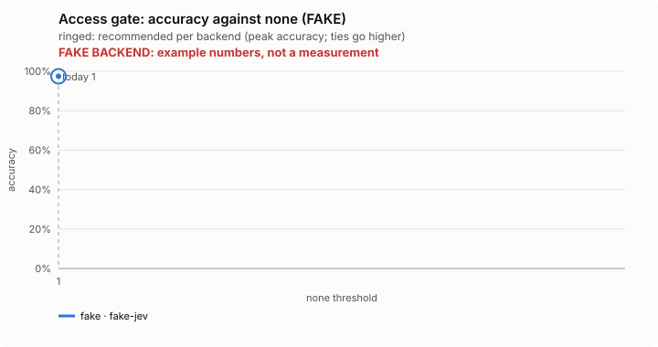
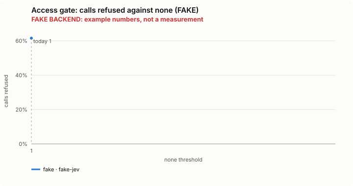
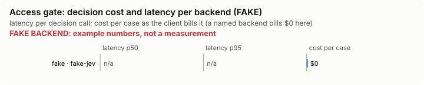

# Access gate: bench summary (FAKE backend)

> **FAKE BACKEND.** These numbers come from the bench's fake decision model and show only that the pipeline works. They say nothing about any model.

**Bench** (`bun src/bench/report.ts access-gate`; 0.11.0@c226712).

- **One case:** a tool call (a shell command, a file read, a web fetch) with what this session has already allowed, and the answer a careful person would give: refuse it or let it through.
- **Measured:** the gate reads each call locally with patterns (no decision model), so this checks its pattern reading. Letting a call reach another machine or read a key is the costly miss; refusing local work is the annoying one.
- **The setting:** there is none: the gate has no confidence bar, every answer is refuse or allow, so the plot is one point.

**Compared with plain Claude Code: not yet.** No task-level run of this feature (a real Claude Code session with it off, then on, on the same task) has been made.

**Decision level.** Jev answers each case by itself, and the bench replays its answers at every value of `none`. Best = where accuracy peaks; a tie goes to the higher value: there is no threshold: the gate reads each call locally and every answer is 0 or 1.

**What this means.** the gate gives the answer a careful person would on 97.4% of the 117 calls.

| backend · model | cases | best | accuracy | precision | recall | F1 | calls refused | blocked in error | missed | p50 | p95 | cost/case |
|---|---|---|---|---|---|---|---|---|---|---|---|---|
| fake · fake-jev | 117 | 1 | 97.4% | 100.0% | 96.0% | 98.0% | 61.5% | 0 | 3 | – | – | $0 |

- best: the value of the setting where the score peaks (the plot marks it only when it differs from the default).
- accuracy: the share of items where acting or not acting matched the label.
- precision: when the feature acts, how often acting was right.
- recall: of what it should have acted on, how much it did.
- F1: precision and recall in one number.
- calls refused: the share of items the feature acts on, at the best value.
- blocked in error: an extra measure, at the best value.
- missed: an extra measure, at the best value.
- p50, p95: how long a decision call took (the middle one, and the slow end); cost/case: what the decision calls cost per case.

Best per backend:

- fake · fake-jev: none 1 (accuracy 97.4%; default 1: 97.4%)

