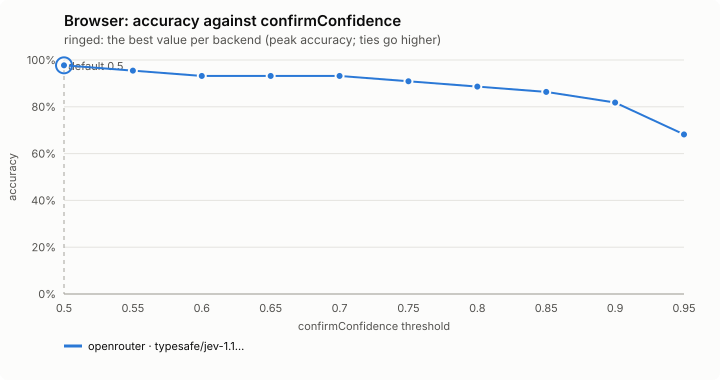
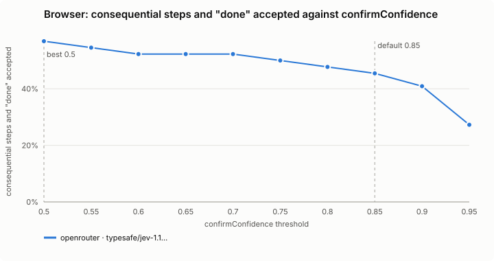
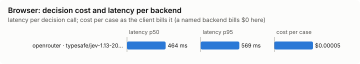

# Browser (`browser`)

A tool the model calls to drive a web page toward a goal; the decision model picks each step. Setup, the tool's inputs, the safety rules, attaching to your own Chrome, cost and known gaps are in [docs/BROWSER.md](../../../docs/BROWSER.md); this page does not copy them.

Modes: `on`, `off`. Default: `off`. It acts for you on the web, so it is the other way round from the guards: a project's file may only turn it off, never on, and sets none of its settings (`allowAttach` among them).

## What it decides

Each step of a web run: which action on the page to take next, toward a goal the model states as an end state, and whether the goal is reached.

## When it runs

When the model calls `browse` (`mcp__jev-mod__browse`), which is offered while the feature is on. It needs Playwright and its Chromium, installed once with `/jev-mod browser install` (a pinned version, into `~/.cache/jev-mod/browser/`; about 150 MB, needs `npm`; only ever run when you ask).

## How it decides

- A headless Chromium on a throwaway profile (Playwright) opens the start page. Each step its links, buttons and fields become a table of actions and the decision model picks one.
- It never writes text: what to type comes from the call's `inputs`, sent to the decision model by name only.
- Page text is redacted and screened first.
- It stays on the start site.
- A consequential step (buy, pay, send, delete, post, sign up, submit a form) waits for you unless the goal names it and the decision model is at least `confirmConfidence` sure the goal asks for it.
- *Done* (or the decision model saying the goal is reached) needs a second check over the page's own text.
- A step the decision model is less sure of than `stepFloor` is not taken: the call stops as blocked with the top three. A named backend can set `choose.min_confidence` (0.5-0.99), which can raise the floor, not lower it, and `choose.dead_repeats` (default 2): how often a step may change nothing before it is dropped.
- It stops early when the decision model says the run is stuck, and at a bot check (Cloudflare, hCaptcha, reCAPTCHA, DataDome, PerimeterX) that does not clear in 8 seconds, naming it. A buy or submit whose result is unknown is never repeated without you. A covered button is not clicked.
- The answer lists the page's console errors and failed requests by step.

## Settings

| Setting | Default | Range | What it does |
|---|---|---|---|
| `maxSteps` | 20 | 5-60 | The most steps one browse call takes; a call may ask for fewer, never more. |
| `confirmConfidence` | 0.85 | 0.5-1 | How sure the decision model must be that the goal asks for a consequential step for it to be taken without you, and that the page shows the goal achieved for *done*. |
| `stepFloor` | 0.4 | 0.3-0.95 | A step the decision model is less sure of than this is not taken. An ordinary step (click, type, scroll) scores 0.35-0.55 on a real site; a consequential one still needs `confirmConfidence` and a goal that names it. |
| `headed` | false | true / false | true: the Chromium window is shown (needs a display). |
| `allowAttach` | false | true / false | true: a call may ask to drive your own Chrome over remote debugging (`JEV_MOD_BROWSER_CDP`, default `http://127.0.0.1:9222`), with your sign-ins, in a new tab it closes after. Only your own file sets it. |
| `textChars` | 6000 | 1000-20000 | About how many characters of each page's main text the decision model reads per step. |

## Failing open, privacy and budget

The browser fails closed and the session fails open: no key, private mode, the daily budget, a backend cool-off or a backend error ends the run as `failed` and closes the browser, and nothing waits. The tool answers with the reason it stopped (blocked, stuck, a bot check, left the allowed hosts, a budget). Page text is redacted, and screened as fetched text is, before the decision model reads it; input values are never sent to it. Every step counts against the daily budget. The band shows the run while it is going.

## Limits

See *Known gaps* in [docs/BROWSER.md](../../../docs/BROWSER.md). A project cannot turn it on or set `allowAttach`.

## Benchmarks

The decision level asks the step, confirm and page-check questions on 59 synthetic page snapshots (below). The task level (`bun src/bench/run.ts browser --level task --backend <name>`; `bench/task.ts`) compares plain Claude Code driving a browser through Playwright MCP with Claude Code using `browse`, on ten requests a person makes about two small made-up websites the bench serves on a loopback port, a fresh copy per arm: a SaaS product (a price behind a billing toggle, a changelog three pages deep, a docs page only the search finds, a sales number behind a dead-end Contact page, a support form, a status page with a region filter, a dashboard behind a login with Delete beside Rename) and a shop (a cart to fill without checking out, a price that shows once a size is chosen, "Buy now" on every product). Both arms get the same words and only their own browser tool. Per case: success (the answer, and what the site's own log says was done), wall time, Claude's cost and turns, the decision model's cost and calls, the pages and actions taken, and any consequential step taken that the request did not ask for (which fails the case). A bench overlay may turn the browser on for this, and it then reaches loopback hosts only.

<!-- bench:start -->
**Bench** (`bun src/bench/report.ts browser`; 0.11.0@14f7f68). Threshold swept: `confirmConfidence` (today 0.85). Recommended = where accuracy peaks; a tie goes to the higher value: a higher bar stops before more consequential steps (the person is asked, and the run resumes) and accepts "done" less often.

| backend · model | cases | recommended | accuracy | precision | recall | F1 | consequential steps and "done" accepted | next right % | reached right % | stuck right % | risky picked wrongly | p50 | p95 | cost/case |
|---|---|---|---|---|---|---|---|---|---|---|---|---|---|---|
| openrouter · typesafe/jev-1.13-20260917 | 59 | 0.5 | 97.7% | 100.0% | 96.2% | 98.0% | 56.8% | 88.1 | 98.3 | 100 | 0 | 472 ms | 577 ms | $0.00004 |

Recommended per backend:

- openrouter · typesafe/jev-1.13-20260917: confirmConfidence 0.5 (accuracy 97.7%; today's 0.85: 86.4%)
<!-- bench:end -->
