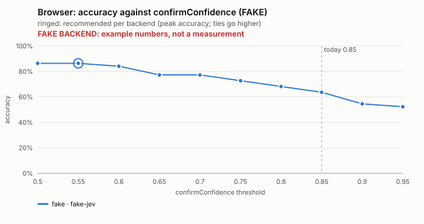
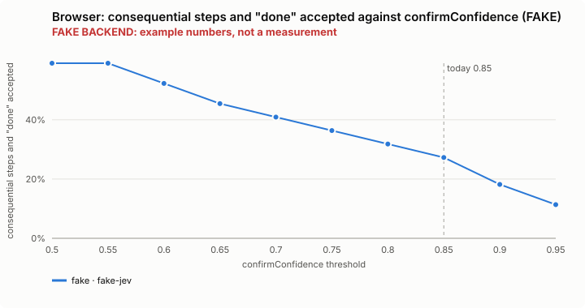
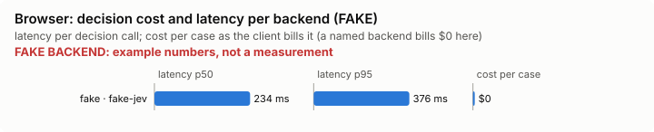

# Browser: bench summary (FAKE backend)

> **FAKE BACKEND.** These numbers come from the bench's fake decision model and show only that the pipeline works. They say nothing about any model.

**Bench** (`bun src/bench/report.ts browser`; 0.11.0@c226712).

- **One case:** a web page the browser agent is looking at (a made-up snapshot of its buttons and links), with a goal such as "buy the blue mug".
- **Measured:** whether Jev says to go ahead on the risky step (buy, send, delete) only when the goal asks for it, and to accept "done" only when the page shows it. Also the next-step pick, goal reached and stuck, as extra columns. Going ahead on a step the goal did not ask for is the costly mistake.
- **The setting:** how sure Jev must be that the goal asks for a risky step before the agent takes it; below that the person is asked first. Higher means more questions and fewer wrong purchases. (`confirmConfidence`, default 0.85)

**Compared with plain Claude Code: not yet.** No task-level run of this feature (a real Claude Code session with it off, then on, on the same task) has been made.

**Decision level.** Jev answers each case by itself, and the bench replays its answers at every value of `confirmConfidence`. Best = where accuracy peaks; a tie goes to the higher value: a higher bar stops before more consequential steps (the person is asked, and the run resumes) and accepts "done" less often.

**What this means.** At the default 0.85, Jev gives the right go-ahead answer on 63.6% of the questions over the 59 pages; at the best value found, 0.55, the same score is 86.4%. The shipped default (0.85) is not the best value found (0.55). It is kept on purpose: lowering it asks the person less often before buy, send and delete steps, so it stays at 0.85 until the real-browser comparison shows what that costs.

| backend · model | cases | best | accuracy | precision | recall | F1 | consequential steps and "done" accepted | next right % | reached right % | stuck right % | risky picked wrongly | p50 | p95 | cost/case |
|---|---|---|---|---|---|---|---|---|---|---|---|---|---|---|
| fake · fake-jev | 59 | 0.55 | 86.4% | 88.5% | 88.5% | 88.5% | 59.1% | 71.2 | 83.1 | 98.3 | 1 | 234 ms | 376 ms | $0 |

- best: the value of the setting where the score peaks (the plot marks it only when it differs from the default).
- accuracy: the share of items where acting or not acting matched the label.
- precision: when the feature acts, how often acting was right.
- recall: of what it should have acted on, how much it did.
- F1: precision and recall in one number.
- consequential steps and "done" accepted: the share of items the feature acts on, at the best value.
- next right %: how often Jev picked the right next button or link on the page.
- reached right %: how often Jev was right about whether the goal was already reached.
- stuck right %: how often Jev was right about whether the run was stuck.
- risky picked wrongly: pages where the step Jev picked was a risky one the goal did not ask for.
- p50, p95: how long a decision call took (the middle one, and the slow end); cost/case: what the decision calls cost per case.

Best per backend:

- fake · fake-jev: confirmConfidence 0.55 (accuracy 86.4%; default 0.85: 63.6%)

