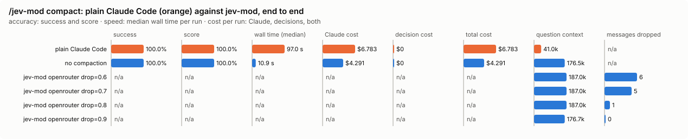

# `/jev-mod compact`

A compaction with no summary. Old tool calls with their results, where most of a session's tokens are, are saved in full to files Claude can Read, then dropped or cut down to the start and end the decision model says later work needs; messages it confidently marks as chatter are dropped. Nothing is summarised.

There is no mode setting: it runs when you type it. `/compact` is left as Claude Code has it, unless its instructions are this compaction's marker (below).

## What it decides

- **For each tool call with its result** outside the last six messages, in one request: whether the pair stays in the conversation at all (*keep* or *drop*); and, for a result over 1,300 characters, how many characters of its start to keep (0, 100, 300 or 600) and how many of its end (0, 100, 300 or 600). A kept call stays exactly as it was.
- **For each long tool result in the last six messages**: how much of its start and end to keep, as above. A pair there is never dropped.
- Not a decision: **thinking** goes from every assistant message (below).
- **For each message with text and no tool call or result**: *keep* or *drop*.

## When it runs

When you type `/jev-mod compact`. (A command's own hook may not compact, so it queues the built-in `/compact` from a timer and answers that one compaction instead of the summariser.)

Headless (`claude -p`), the process ends when the command returns, before that timer fires, so `/jev-mod compact` says so and nothing is compacted. There, send the same compaction in one step:

```bash
claude -p --resume <session> "/compact [jev-mod compact: drop only what Jev marks drop]"
```

A `/compact` typed with that marker as its instructions is answered the same way in any session. An automatic compaction, a subagent's, or a `/compact` with other instructions goes to Claude Code's summariser as usual.

## How it decides

- **Tool pairs.** For each tool call and its result, the decision model sees the tool, its main argument (the command, file path, pattern or URL), the result's size, and its first and last 600 characters, redacted (a result of 1,300 characters or fewer is shown whole). Each question asks whether a later step would need it in front of it, or could re-read the file: should the pair stay at all, and if it stays, how much of the result's start and of its end. Before anything is cut, the full call and result are written to a file.
  - **Dropped**: the call and its result go together, so every tool call left still has its result. A message left with nothing in it goes; one left with text (a line like "Let me read the file") keeps it.
  - **Kept and trimmed**: the result becomes the kept start, one line, the kept end. The line names the tool, its main argument, how many characters were cut of how many, and the file, and says to Read it for the rest. For example:

    ```
    …the first 100 characters…
    [jev-mod compact trimmed this Read (/work/ledgerline/logs/staging-app.log) result: 66,106 of its 66,506 characters were cut, keeping its first 100 and last 300. The full call and result are in /home/you/.cache/jev-mod/compact/<session>/toolu_01AbC.txt; Read it if you need the rest.]
    …the last 300 characters…
    ```

    When the kept start and end cover the whole result, or the line would not make it shorter, it is left as it was. A short result is kept whole when the pair stays (asking how far to trim it would cost more than it saves).
- **Thinking.** Every assistant message is handed back to Claude Code rebuilt from its text and tool calls, so its thinking is left out, and a message that held only thinking goes. This is not asked. A later turn does not need an earlier turn's thinking, and the API allows leaving it out of every turn but the last one of an unfinished tool loop, which a compaction between turns never has. It is also how the compaction holds after a resume: a message handed back as Claude Code had it keeps its API message id, and a resumed session gathers every row of the transcript with that id, bringing back the thinking, the dropped tool calls and the text a second time (on one bench session the resumed question read 82k tokens; with every assistant message rebuilt, 26k).
- **Messages.** Keep means: a decision, a constraint, a user preference, an unfinished task, an exact value, path, id, command or error that later work depends on, or background whose gist later work needs. Drop means chatter, acknowledgements, superseded attempts, repeated output, or detail nothing later depends on. A message goes only when its text was judged drop with confidence of at least 0.5 (`DROP_CONFIDENCE` in `src/engine/compact.ts`). A long text is judged on its first and last 350 characters, redacted. The text of a message that holds a tool call or result is not sent: that message's tool pairs decide it.
- **Doubt keeps, sized to the choice.** A drop below the same 0.5 confidence keeps the pair (and its result is then trimmed as answered); a size below it keeps all 600 characters of that end. A pair is left whole, and no file is written for it, when the decision model did not judge it (it was down, timed out, or answered only part), when the call or the full result held something sensitive (never sent), when its call is no longer in the conversation, when it is among the last six messages and its result is 1,300 characters or shorter, or when its file could not be written privately. A pair among the last six messages is never dropped. A text it did not judge stays. Errors are judged like any other result; the file keeps them whole.
- Requests are packed by encoded size: texts up to 40 to a request, tool pairs up to 20 (three questions each, one for a short result).
- A note goes first in the compacted conversation: how many messages went, how many tool pairs were dropped and results trimmed, and the folder that holds their files. Nothing is summarised.

## The files

One folder per session, one file per dropped or trimmed pair: `<XDG_CACHE_HOME or ~/.cache>/jev-mod/compact/<session id>/<tool_use_id>.txt`, holding the call (its tool and full input) and the whole result. The folder is made private (0700) before anything is written, and each file is 0600; if that fails, nothing is dropped or trimmed. They are never written into your project. A session folder untouched for 30 days is removed at the next compaction. In a bench run they go to the run's scratch folder instead (`compact-files/` under the run's ledger).

## Settings

None.

## Failing open, privacy and budget

Nothing is removed when the decision model does not answer, when it marks nothing to drop or trim, when today's budget is spent (one compaction is charged against it, all its requests together), or when the profile is private (nothing is sent). A toast says why. Text is redacted before it is sent, and a text, call or result that looks sensitive is never sent.

## Limits

- Dropping and trimming are not undone in the conversation; a dropped or trimmed tool pair is still whole in its file, a dropped message is gone. So doubt keeps.
- The tail (six messages) is always kept, except that a long tool result there may be trimmed, and thinking goes there too.
- A message that holds a kept tool call keeps its text, even chatter.
- Claude has to Read a file to see what was cut. The task bench refuses every tool when it asks its questions, so it measures what survives in context only.

## Benchmarks

Two benches (src/bench/README.md). The decision level asks Jev about ten labelled sessions and sweeps the drop bar; it scores keep or drop on messages with text and no tool call only (tool pairs are not asked there). The task level builds three long, real coding sessions in `bench/task-fixture/` (a bug fix, a feature, an investigation; about 105k tokens of conversation each), compacts a fork of each with `/compact`, with this compaction at its default, and not at all, then asks what a continuation needs with every tool refused. In a bench run the compaction writes the messages and tool pairs it dropped and the results it trimmed to the run's ledger; an arm whose question did not read a meaningfully smaller context, or that did none of these, is `not_compacted`, never a score. Each arm's compaction step and question step are timed apart (`step_ms` in its rows; the report's compaction time and question time). One pass of three cases costs about $69 in Claude calls (`bun src/bench/run.ts compact --level task --backend <name>` prints the plan).

<!-- bench:start -->
**Bench** (`bun src/bench/report.ts compact`; 0.11.0@14f7f68, 0.13.2@19bacff).

- **One case:** a made-up coding session, each message labelled keep or drop by a careful person (keep: a decision, a constraint, an exact path or error; drop: chatter, superseded attempts).
- **Measured:** for each message with text and no tool call or result (a tool call with its result is judged as a pair, not scored here), outside the last six (always kept), whether Jev's keep or drop call matches the label. Dropping a message labelled keep is the costly mistake: it cannot be had back.
- **The setting:** how sure Jev must be that a message can go before /jev-mod compact drops it. Higher keeps more. (`drop`, default 0.5)

**Compared with plain Claude Code:**



| arm | runs | success | mean score | median time | total time | Claude cost | feature decision cost | other jev-mod decision cost | total cost |
|---|---|---|---|---|---|---|---|---|---|
| plain Claude Code | 3 | 100.0% | 100.0% | 53.3 s | 158.7 s | $5.956 | $0 | $0 | $5.956 |
| no compaction | 3 | 100.0% | 100.0% | 8599 ms | 27.8 s | $4.025 | $0 | $0 | $4.025 |
| jev-mod openrouter | 3 | 100.0% | 100.0% | 12.7 s | 40.7 s | $5.661 | $0.00171 | $0 | $5.663 |

- success: the share of scored runs the checker marked right; mean score: its partial credit (the share of questions answered right, say).
- median time: over scored runs; total time: every run of the arm, failed ones too.
- costs are per scored run. Feature decision cost: what compact's own decisions cost; other jev-mod decision cost: what other jev-mod features still asked in the arm (a protective feature the bench may not switch off, as the person has it). Total cost is Claude plus both. A failed run is never scored.
- plain Claude Code runs with jev-mod switched off whole, so it makes no decisions; a plain run that shows any is an error (`decisions_in_plain_arm`). Runs from jev-mod 0.12.0 and before switched off only the features that change what the model sees.

- jev-mod openrouter: right on 100.0% (plain Claude Code 100.0%) of runs, median 12.7 s (plain Claude Code 53.3 s), $5.663 (plain Claude Code $5.956) per run (Claude $5.661, compact's decisions $0.00171, other jev-mod decisions $0).

| arm | question context | kept / dropped | tool pairs dropped / trimmed | compaction time | question time | Claude tokens |
|---|---|---|---|---|---|---|
| plain Claude Code | 25.9k | – | – | 44.9 s | 9040 ms | 26696 |
| no compaction | 165.6k | – | – | – | 8599 ms | 166321 |
| jev-mod openrouter | 29.2k | 42 / 131 of 173 | 49 / 2 (235k chars) | 4631 ms | 8410 ms | 30006 |

- question context: what the last step read, in tokens (a smaller one is a compaction that worked); kept / dropped: messages the compaction kept and dropped, of those before it; tool pairs dropped / trimmed: tool calls dropped with their results, and results cut down, with the characters that took out (each pair saved in full to a file); compaction time and question time: the median wall time of the compaction step and of the question step, over every run (no compaction has no compaction step).

Spend in all: $96.006 Claude, of which the shared setup $49.079 (3 case(s), 933.5 s); $0.00512 decisions. A failed run is never scored, but its spend counts here.

**Decision level.** Jev answers each case by itself, and the bench replays its answers at every value of `drop`. Best = where accuracy peaks; a tie goes to the higher value: a higher bar keeps more, and a dropped message cannot be had back.

**What this means.** At the default 0.5, Jev makes the same keep or drop call as the label on 95.4% of the messages in 10 sessions. No value in the sweep does better, so the default stays.


| backend · model | cases | best | accuracy | precision | recall | F1 | messages dropped | keep lost | p50 | p95 | cost/case |
|---|---|---|---|---|---|---|---|---|---|---|---|
| openrouter · typesafe/jev-1.13-20260917 | 10 | 0.5 | 95.4% | 100.0% | 91.9% | 95.8% | 52.3% | 0 | 474 ms | 710 ms | $0.00008 |

- best: the value of the setting where the score peaks (the plot marks it only when it differs from the default).
- accuracy: the share of items where acting or not acting matched the label.
- precision: when the feature acts, how often acting was right.
- recall: of what it should have acted on, how much it did.
- F1: precision and recall in one number.
- messages dropped: the share of items the feature acts on, at the best value.
- keep lost: messages labelled keep that were dropped: the costly mistake.
- p50, p95: how long a decision call took (the middle one, and the slow end); cost/case: what the decision calls cost per case.

Best per backend:

- openrouter · typesafe/jev-1.13-20260917: drop 0.5 (accuracy 95.4%; default 0.5: 95.4%)
<!-- bench:end -->
