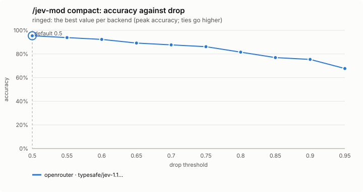
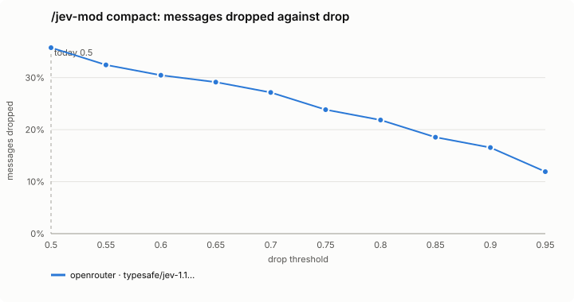
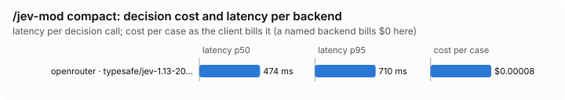

# `/jev-mod compact`

A compaction with no summary: the decision model marks what to keep, and everything else is dropped.

There is no mode setting: it runs when you type it. `/compact` is left as Claude Code has it, unless its instructions are this compaction's marker (below).

## What it decides

For each message's text, and for each tool call together with its result, *keep* or *drop*. A call and its result always share one fate.

## When it runs

When you type `/jev-mod compact`. (A command's own hook may not compact, so it queues the built-in `/compact` from a timer and answers that one compaction instead of the summariser.)

Headless (`claude -p`), the process ends when the command returns, before that timer fires, so `/jev-mod compact` says so and nothing is compacted. There, send the same compaction in one step:

```bash
claude -p --resume <session> "/compact [jev-mod compact: drop only what Jev marks drop]"
```

A `/compact` typed with that marker as its instructions is answered the same way in any session. An automatic compaction, a subagent's, or a `/compact` with other instructions goes to Claude Code's summariser as usual.

## How it decides

- The decision model sees the tool, its main argument such as the command or file path, and the result's start and end, redacted and cut to under 700 characters, saying how much is not shown. Requests are packed by encoded size, up to 40 turns each.
- Keep means: a decision, a constraint, a user preference, an unfinished task, an exact value, path, id, command or error that later work depends on, or background whose gist later work needs. Drop means chatter, acknowledgements, superseded attempts, repeated output, or detail nothing later depends on.
- A message goes only when every part of it was judged drop with confidence of at least 0.5 (0.7 before 0.12.0; the bench below found accuracy peaks at 0.5 on Jev).
- Everything else stays: low-confidence drops, anything it did not judge (it was down, timed out, answered only part, or the text, call or result held something sensitive that is never sent), the last six messages, and both halves of any kept tool call.
- A note replaces what was removed, saying how many messages were kept and that nothing was summarised.
- Nothing is summarised.

## Settings

None.

## Failing open, privacy and budget

Nothing is removed when the decision model does not answer, when it marks no turn drop, or when today's budget is spent (one compaction is charged against it, its batches together). A toast says why. Text is redacted before it is sent.

## Limits

- Dropping is the one decision that cannot be undone, so doubt keeps.
- The tail (six messages) is always kept.
- A text with something sensitive is never judged, so it stays.

## Benchmarks

Two benches (src/bench/README.md). The decision level asks Jev about ten labelled sessions and sweeps the drop bar. The task level builds three long, real coding sessions in `bench/task-fixture/` (a bug fix, a feature, an investigation; about 105k tokens of conversation each), compacts a fork of each with `/compact`, with this compaction at each drop bar, and not at all, then asks what a continuation needs with every tool refused. In a bench run the compaction writes what it kept and dropped to the run's ledger; an arm whose question did not read a meaningfully smaller context, or that dropped nothing, is `not_compacted`, never a score. It is not run yet: one pass costs about $105 in Claude calls (`bun src/bench/run.ts compact --level task --backend <name> --sweep drop=0.6:0.9:0.1` prints the plan).

<!-- bench:start -->
**Bench** (`bun src/bench/report.ts compact`; 0.11.0@14f7f68). Threshold swept: `drop` (today 0.5). Recommended = where accuracy peaks; a tie goes to the higher value: a higher bar keeps more, and a dropped message cannot be had back.





| backend · model | cases | recommended | accuracy | precision | recall | F1 | messages dropped | keep lost | p50 | p95 | cost/case |
|---|---|---|---|---|---|---|---|---|---|---|---|
| openrouter · typesafe/jev-1.13-20260917 | 10 | 0.5 | 88.7% | 100.0% | 76.1% | 86.4% | 35.8% | 0 | 474 ms | 710 ms | $0.00008 |

Recommended per backend:

- openrouter · typesafe/jev-1.13-20260917: drop 0.5 (accuracy 88.7%; today's 0.5: 88.7%)
<!-- bench:end -->
