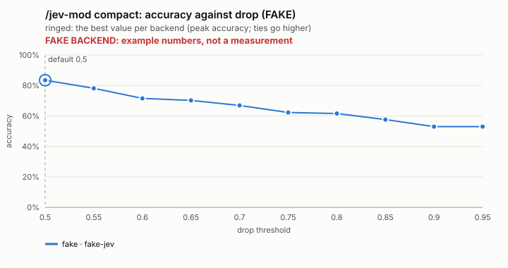
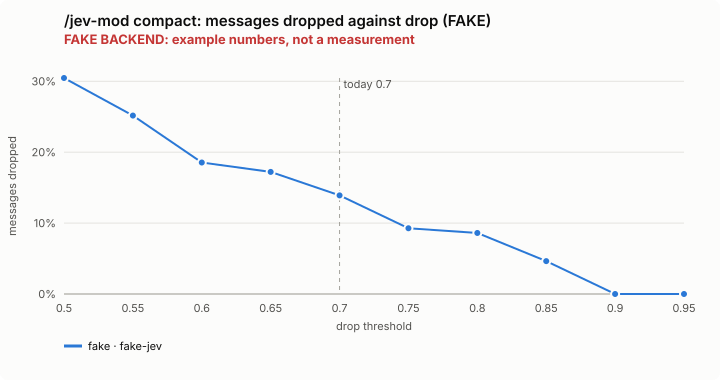
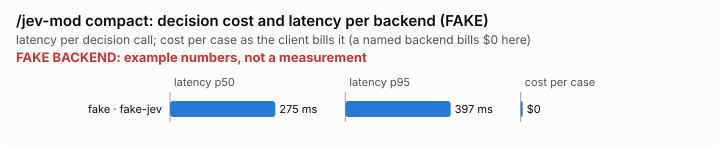

# /jev-mod compact: bench summary (FAKE backend)

> **FAKE BACKEND.** These numbers come from the bench's fake decision model and show only that the pipeline works. They say nothing about any model.

**Bench** (`bun src/bench/report.ts compact`; 0.10.0@f040686). Threshold swept: `drop` (today 0.7). Recommended = where accuracy peaks; a tie goes to the higher value: a higher bar keeps more, and a dropped message cannot be had back.

| backend · model | cases | recommended | accuracy | precision | recall | F1 | messages dropped | keep lost | p50 | p95 | cost/case |
|---|---|---|---|---|---|---|---|---|---|---|---|
| fake · fake-jev | 10 | 0.5 | 83.4% | 100.0% | 64.8% | 78.6% | 30.5% | 0 | 275 ms | 397 ms | $0 |

Recommended per backend:

- fake · fake-jev: drop 0.5 (accuracy 83.4%; today's 0.7: 66.9%)

