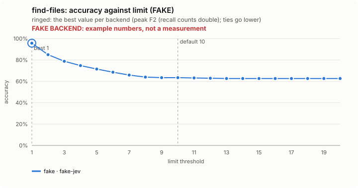
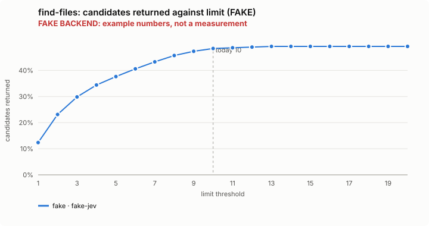
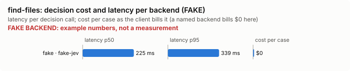

# find-files: bench summary (FAKE backend)

> **FAKE BACKEND.** These numbers come from the bench's fake decision model and show only that the pipeline works. They say nothing about any model.

**Bench** (`bun src/bench/report.ts find-files`; 0.11.0@c226712).

- **One case:** a plain-words question about a made-up shop project (about 75 files), such as "where do we apply discounts", with the files that implement it.
- **Measured:** the order Jev lists the files in: of the first k files returned, how many are the implementing ones, and how many implementing files are missed. Some queries have no right file, which measures the noise returned.
- **The setting:** how many files the tool returns (it has no relevance bar). Fewer files is less for the model to open; more files misses fewer. (`limit`, default 10)

**Compared with plain Claude Code: not yet.** No task-level run of this feature (a real Claude Code session with it off, then on, on the same task) has been made.

**Decision level.** Jev answers each case by itself, and the bench replays its answers at every value of `limit`. Best = peak F2 (recall counts double); a tie goes to the lower value: a lower limit returns fewer files for the model to open and read; the cost is a miss when the right file ranks below it.

**What this means.** At the default 10, the files returned are the right ones (accuracy over every candidate file) on 63.4%, over 48 queries; at the best value found, 1, the same score is 95.7%. The shipped default (10) is not the best value found (1). Not yet changed.

| backend · model | cases | best | accuracy | precision | recall | F1 | candidates returned | queries with a hit | local-only F1 | gold the local step missed | p50 | p95 | cost/case |
|---|---|---|---|---|---|---|---|---|---|---|---|---|---|
| fake · fake-jev | 48 | 1 | 95.7% | 82.6% | 82.6% | 82.6% | 12.4% | 0.844 | 0.903 | 0.022 | 225 ms | 339 ms | $0 |

- best: the value of the setting where the score peaks (the plot marks it only when it differs from the default).
- accuracy: the share of items where acting or not acting matched the label.
- precision: when the feature acts, how often acting was right.
- recall: of what it should have acted on, how much it did.
- F1: precision and recall in one number.
- candidates returned: the share of items the feature acts on, at the best value.
- queries with a hit: an extra measure, at the best value.
- local-only F1: an extra measure, at the best value.
- gold the local step missed: an extra measure, at the best value.
- p50, p95: how long a decision call took (the middle one, and the slow end); cost/case: what the decision calls cost per case.

Best per backend:

- fake · fake-jev: limit 1 (accuracy 95.7%; default 10: 63.4%)

