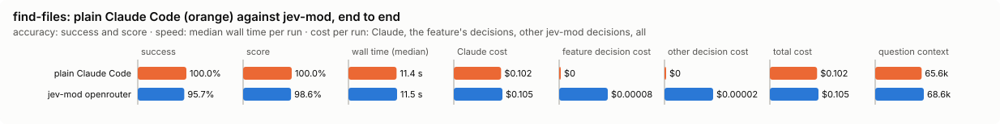
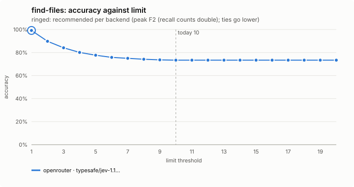
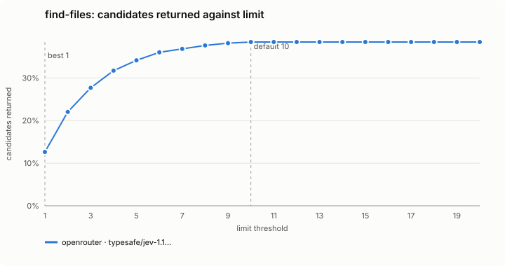
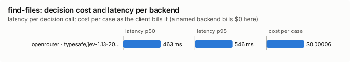

# find-files: bench summary

**Bench** (`bun src/bench/report.ts find-files`; 0.11.0@14f7f68, 0.14.0@8d6d53a).

- **One case:** a plain-words question about a made-up shop project (about 75 files), such as "where do we apply discounts", with the files that implement it.
- **Measured:** the order Jev lists the files in: of the first k files returned, how many are the implementing ones, and how many implementing files are missed. Some queries have no right file, which measures the noise returned.
- **The setting:** how many files the tool returns (it has no relevance bar). Fewer files is less for the model to open; more files misses fewer. (`limit`, default 10)

**Compared with plain Claude Code:**

| arm | runs | success | mean score | median time | total time | Claude cost | feature decision cost | other jev-mod decision cost | total cost |
|---|---|---|---|---|---|---|---|---|---|
| plain Claude Code | 23 | 100.0% | 100.0% | 11.4 s | 277.5 s | $0.102 | $0 | $0 | $0.102 |
| jev-mod openrouter | 23 | 95.7% | 98.6% | 11.5 s | 269.5 s | $0.105 | $0.00008 | $0.00002 | $0.105 |

- success: the share of scored runs the checker marked right; mean score: its partial credit (the share of questions answered right, say).
- median time: over scored runs; total time: every run of the arm, failed ones too.
- costs are per scored run. Feature decision cost: what find-files's own decisions cost; other jev-mod decision cost: what other jev-mod features still asked in the arm (a protective feature the bench may not switch off, as the person has it). Total cost is Claude plus both. A failed run is never scored.
- plain Claude Code runs with jev-mod switched off whole, so it makes no decisions; a plain run that shows any is an error (`decisions_in_plain_arm`). Runs from jev-mod 0.12.0 and before switched off only the features that change what the model sees.

- jev-mod openrouter: right on 95.7% (plain Claude Code 100.0%) of runs, median 11.5 s (plain Claude Code 11.4 s), $0.105 (plain Claude Code $0.102) per run (Claude $0.105, find-files's decisions $0.00008, other jev-mod decisions $0.00002).

| arm | question context | kept / dropped | tool pairs dropped / trimmed | compaction time | question time | Claude tokens |
|---|---|---|---|---|---|---|
| plain Claude Code | 65.6k | – | – | – | 11.4 s | 66259 |
| jev-mod openrouter | 68.6k | – | – | – | 11.5 s | 69316 |

- question context: what the last step read, in tokens (a smaller one is a compaction that worked); kept / dropped: messages the compaction kept and dropped, of those before it; tool pairs dropped / trimmed: tool calls dropped with their results, and results cut down, with the characters that took out (each pair saved in full to a file); compaction time and question time: the median wall time of the compaction step and of the question step, over every run (no compaction has no compaction step).

Spend in all: $4.781 Claude; $0.00243 decisions. A failed run is never scored, but its spend counts here.

**By suite.** The small fixture (tillbox, 320 files) and the large project (saleor 3.23.0, ~4,500 files) apart; find_files calls are read from the ledger, so a call that asked no decision model still counts.

| suite | arm | runs | success | mean score | median time | Claude $/run | decisions $/run | runs that called find_files | find_files answers |
|---|---|---|---|---|---|---|---|---|---|
| large project | claude | 13 | 100% | 100% | 11598 ms | $0.113 | $0.00000 | 0 of 13 | - |
| large project | jev-mod openrouter | 13 | 100% | 100% | 11588 ms | $0.118 | $0.00002 | 0 of 13 | - |
| small fixture | claude | 10 | 100% | 100% | 10185 ms | $0.089 | $0.00000 | 0 of 10 | - |
| small fixture | jev-mod openrouter | 10 | 90% | 97% | 11473 ms | $0.089 | $0.00022 | 6 of 10 | clear 1, jev 4, symbol 1 |

**Decision level.** Jev answers each case by itself, and the bench replays its answers at every value of `limit`. Best = peak F2 (recall counts double); a tie goes to the lower value: a lower limit returns fewer files for the model to open and read; the cost is a miss when the right file ranks below it.

**What this means.** At the default 10, the files returned are the right ones (accuracy over every candidate file) on 73.4%, over 48 queries; at the best value found, 1, the same score is 99.2%. The shipped default (10) is not the best value found (1). Not yet changed.

| backend · model | cases | best | accuracy | precision | recall | F1 | candidates returned | queries with a hit | local-only F1 | gold the local step missed | p50 | p95 | cost/case |
|---|---|---|---|---|---|---|---|---|---|---|---|---|---|
| openrouter · typesafe/jev-1.13-20260917 | 48 | 1 | 99.2% | 95.7% | 97.8% | 96.8% | 12.6% | 1 | 0.903 | 0.022 | 463 ms | 546 ms | $0.00006 |

- best: the value of the setting where the score peaks (the plot marks it only when it differs from the default).
- accuracy: the share of items where acting or not acting matched the label.
- precision: when the feature acts, how often acting was right.
- recall: of what it should have acted on, how much it did.
- F1: precision and recall in one number.
- candidates returned: the share of items the feature acts on, at the best value.
- queries with a hit: an extra measure, at the best value.
- local-only F1: an extra measure, at the best value.
- gold the local step missed: an extra measure, at the best value.
- p50, p95: how long a decision call took (the middle one, and the slow end); cost/case: what the decision calls cost per case.

Best per backend:

- openrouter · typesafe/jev-1.13-20260917: limit 1 (accuracy 99.2%; default 10: 73.4%)

