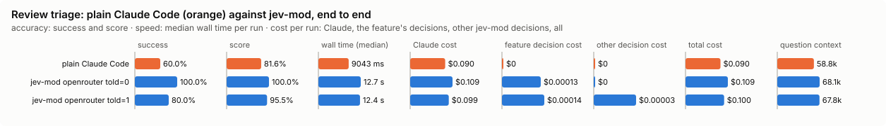

# Review triage (`review-triage`)

How deep should the first pass of a code review go? Decided at prompt submit when the prompt asks for a review, and by a tool the model can call when it did not.

Modes: `on`, `shadow`, `off`. Default: `off`, as shipped for this feature before the hook: every use of the decision model is opt-in, and turning this on adds a decision call to each review request. With `off` the hook does nothing (the bench turns the feature on). `shadow` runs the hook, counts what it would have injected (`would-inject`) and adds nothing; the tool is offered only in `on`.

## What it decides

*quick* (one review pass is enough) or *full*, and which files to look at first. It never replaces the review; it only sets how deep the first pass goes.

## When it runs

**At prompt submit (the hook).** A cheap local check decides whether the prompt asks for a review of a change: "review" (or "look over", "go through", "audit") used as a verb with a code word (diff, changes, PR, commit, patch, branch, code) within a few words after it, or "do/give/need a code review". "Review the paper", "a review step in the code" or "peer review" do not match. A false match costs one decision call; a miss leaves the tool to the model. On a match the hook runs the same triage the tool runs, on the same git diff (uncommitted changes against HEAD, else the last commit), with the same redaction, secret-shaped skip, budget, private mode and cool-off, and adds the verdict as context beside the prompt (and a toast). The prompt's own text is never sent, and no intent is passed. If the decision model gives no answer (no key, budget, timeout, backend down, a diff too large, nothing to triage, a diff that is mostly secrets) nothing is added and the prompt goes on as it would have. Counted as `injected` (on) or `would-inject` (shadow), beside the usual `quick`/`full`/`undecided`. A review of other changes (a branch or PR named in the prompt) is for the tool, which takes a `base`.

**By the tool.** When the model calls `review_triage` (`mcp__jev-mod__review_triage`) before a code review, which is offered while the feature is on. With `off`, the tool is not offered (a session started while it was on keeps it, and it answers that it is off).

## How it decides

The git diff goes to the decision model: the uncommitted changes against HEAD, else the last commit, or the changes since a `base` the model names. It is redacted and cut to `maxDiffChars` (12,000), with up to seven yes/no questions:

1. security-sensitive code;
2. hard-to-undo data changes;
3. a public interface others rely on;
4. runtime-only failures;
5. a rule in the project's CLAUDE.md or AGENTS.md (skipped when the project wrote none);
6. behaviour changed without a test;
7. work beyond the stated intent (with no intent given: anything unfinished or inconsistent).

*quick* only when every answer is a confident no (at least `minConfidence`). Otherwise *full*, naming the questions and the files behind them (one more request asks which files).

*full* without asking, for these reasons: a hunk that looks like it holds or handles a secret is not sent; any hunk or file cut away to fit (the whole request, files list and rules included, stays under the backend's limit); an untracked text file over 1 MB; a diff over ten times `maxDiffChars`, which is not sent at all.

## Settings

| Setting | Default | Range | What it does |
|---|---|---|---|
| `minConfidence` | 0.8 | 0.5-1 | How sure the decision model must be of each *no* for the verdict to be *quick*. Higher answers *full* more often. |
| `maxDiffChars` | 12000 | 2000-40000 | About how many characters of the diff are sent; a larger diff is cut to fit, and one over ten times this is not triaged. |
| `timeoutMs` | 8000 | 1000-30000 | How long the tool waits for the decision model before it answers *full*. |

## Failing open, privacy and budget

No key, private mode, the daily budget, a failing backend, no answer within `timeoutMs`, or a diff too large to triage: the tool answers *full*, with the reason; the hook adds nothing. The diff is redacted; a part that looks like it holds a secret is not sent.

## Limits

- It judges the diff, not the code around it.
- It only sets how deep the first pass goes. It never says a change is fine.
- At most 50 untracked files are read.

## Benchmarks

<!-- bench:start -->
**Bench** (`bun src/bench/report.ts review-triage`; 0.11.0@14f7f68, 0.12.0@55065cf).

- **One case:** a change (a git diff) with its intent and the project's written rules, and whether it needs a full review or one quick pass is enough.
- **Measured:** whether Jev calls a change quick only when it is. Calling a change quick that needs a full review skips the review: that is the costly mistake. Calling a quick one full only costs time.
- **The setting:** how sure Jev must be, on every one of seven questions, that nothing is wrong before the change is called quick. Higher means fewer quick calls. (`minConfidence`, default 0.8)

**Compared with plain Claude Code:**

| arm | runs | success | mean score | median time | total time | Claude cost | feature decision cost | other jev-mod decision cost | total cost |
|---|---|---|---|---|---|---|---|---|---|
| plain Claude Code | 10 | 60.0% | 81.6% | 9043 ms | 95.6 s | $0.090 | $0 | $0 | $0.090 |
| jev-mod openrouter told=0 | 10 (failed: 5 not_triaged) | 100.0% | 100.0% | 12.7 s | 119.6 s | $0.109 | $0.00013 | $0 | $0.109 |
| jev-mod openrouter told=1 | 10 | 80.0% | 95.5% | 12.4 s | 139.3 s | $0.099 | $0.00014 | $0.00003 | $0.100 |

- success: the share of scored runs the checker marked right; mean score: its partial credit (the share of questions answered right, say).
- median time: over scored runs; total time: every run of the arm, failed ones too.
- costs are per scored run. Feature decision cost: what review-triage's own decisions cost; other jev-mod decision cost: what other jev-mod features still asked in the arm (a protective feature the bench may not switch off, as the person has it). Total cost is Claude plus both. A failed run is never scored.
- plain Claude Code runs with jev-mod switched off whole, so it makes no decisions; a plain run that shows any is an error (`decisions_in_plain_arm`). Runs from jev-mod 0.12.0 and before switched off only the features that change what the model sees.

- jev-mod openrouter told=0: right on 100.0% (plain Claude Code 60.0%) of runs, median 12.7 s (plain Claude Code 9043 ms), $0.109 (plain Claude Code $0.090) per run (Claude $0.109, review-triage's decisions $0.00013, other jev-mod decisions $0).
- jev-mod openrouter told=1: right on 80.0% (plain Claude Code 60.0%) of runs, median 12.4 s (plain Claude Code 9043 ms), $0.100 (plain Claude Code $0.090) per run (Claude $0.099, review-triage's decisions $0.00014, other jev-mod decisions $0.00003).

| arm | question context | kept / dropped | Claude tokens |
|---|---|---|---|
| plain Claude Code | 58.8k | – | 59420 |
| jev-mod openrouter told=0 | 68.1k | – | 76026 |
| jev-mod openrouter told=1 | 67.8k | – | 68627 |

- question context: what the last step read, in tokens (a smaller one is a compaction that worked); kept / dropped: messages the compaction kept and dropped, of those before it.

Spend in all: $3.001 Claude; $0.00230 decisions. A failed run is never scored, but its spend counts here.

**Decision level.** Jev answers each case by itself, and the bench replays its answers at every value of `minConfidence`. Best = where accuracy peaks; a tie goes to the higher value: a higher bar answers quick less often, and a full review costs only time; a wrongly quick one skips a review.

**What this means.** At the default 0.8, Jev makes the right quick or full call on 84.3% of the 51 changes; at the best value found, 0.55, the same score is 94.1%. The shipped default (0.8) is not the best value found (0.55). Not yet changed.

| backend · model | cases | best | accuracy | precision | recall | F1 | changes called quick | full skipped | p50 | p95 | cost/case |
|---|---|---|---|---|---|---|---|---|---|---|---|
| openrouter · typesafe/jev-1.13-20260917 | 51 | 0.55 | 94.1% | 100.0% | 82.4% | 90.3% | 27.5% | 0 | 468 ms | 523 ms | $0.00004 |

- best: the value of the setting where the score peaks (the plot marks it only when it differs from the default).
- accuracy: the share of items where acting or not acting matched the label.
- precision: when the feature acts, how often acting was right.
- recall: of what it should have acted on, how much it did.
- F1: precision and recall in one number.
- changes called quick: the share of items the feature acts on, at the best value.
- full skipped: changes that needed a full review but were called quick.
- p50, p95: how long a decision call took (the middle one, and the slow end); cost/case: what the decision calls cost per case.

Best per backend:

- openrouter · typesafe/jev-1.13-20260917: minConfidence 0.55 (accuracy 94.1%; default 0.8: 84.3%)
<!-- bench:end -->

### Task level: what does triage change in a real review?

`bun src/bench/run.ts review-triage --level task --backend openrouter --sweep told=0:1:1` prints a plan; `--yes` runs it.
Ten uncommitted changes to a small shop service (`bench/task-fixture/`, made by `bench/task-fixture-gen.py`), each reviewed the way
a person asks: *I'm about to commit this, review it for bugs* (real defects only, one `FINDING: file:line - text` line each). Three
changes are clean (docs, a rename, logging) and seven carry 12 real defects between them among harmless edits: an off-by-one, a
missing `@require_admin`, SQL built with an f-string, a partial refund that restocks and can refund twice, a migration that
drops a column still read, float money and a swallowed exception, and a coupon with three bugs.

The checker is deterministic. A finding is matched to a defect by file and line (the gold is a line found by a needle in the changed
file, plus two lines either side); a defect matched is caught, a finding that matches no defect is false, and a real but minor
issue the prompt did not ask about is tolerated (neither). A change's score is the F1 of defects caught and false findings (a clean
change: 1 with nothing reported, 0 with anything), and it succeeds when every defect is caught and nothing is false.

Plain Claude Code is the arm without the tool. The jev-mod arm has it offered and its prompt ends with "Use the review_triage tool
first to decide how deep to go", which is what a person who turned the feature on would write in their CLAUDE.md: in the first smoke
Claude Code, offered the tool and told by its description to call it first, did not call it (`told=0` runs that, and an arm that
never calls the tool is an error, `not_triaged`, which is the adoption result). Measured per arm: defects caught, false findings,
wall time, Claude's cost and tokens, the decision cost.

What it can and cannot compare. Triage never reviews: it sets how deep the first pass goes (quick, or full with the files to start
with), and Claude is free to read more. So the bench shows what that hint does to a review, and it cannot show a saving that is
not there: a quick verdict on a clean change should cost less than a full review, and a quick verdict on a buggy one costs the
defect. In the first smoke (`bulk-threshold`, one off-by-one) both arms found it; the jev-mod arm cost $0.006 and 0.4 s more.
