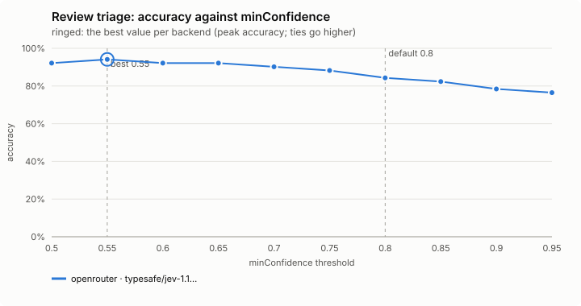
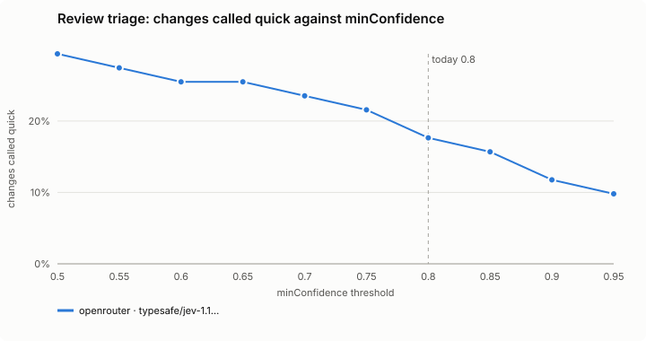
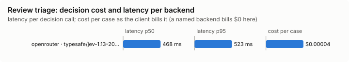

# Review triage (`review-triage`)

A tool the model calls before a code review: how deep should the first pass go?

Modes: `on`, `off`. Default: `off`. There is no shadow: the model calls the tool by choice, so there is nothing to watch it do unasked.

## What it decides

*quick* (one review pass is enough) or *full*, and which files to look at first. It never replaces the review; it only sets how deep the first pass goes.

## When it runs

When the model calls `review_triage` (`mcp__jev-mod__review_triage`) before a code review, which is offered while the feature is on. With `off`, the tool is not offered (a session started while it was on keeps it, and it answers that it is off).

## How it decides

The git diff goes to the decision model: the uncommitted changes against HEAD, else the last commit, or the changes since a `base` the model names. It is redacted and cut to `maxDiffChars` (12,000), with up to seven yes/no questions:

1. security-sensitive code;
2. hard-to-undo data changes;
3. a public interface others rely on;
4. runtime-only failures;
5. a rule in the project's CLAUDE.md or AGENTS.md (skipped when the project wrote none);
6. behaviour changed without a test;
7. work beyond the stated intent (with no intent given: anything unfinished or inconsistent).

*quick* only when every answer is a confident no (at least `minConfidence`). Otherwise *full*, naming the questions and the files behind them (one more request asks which files).

*full* without asking, for these reasons: a hunk that looks like it holds or handles a secret is not sent; any hunk or file cut away to fit (the whole request, files list and rules included, stays under the backend's limit); an untracked text file over 1 MB; a diff over ten times `maxDiffChars`, which is not sent at all.

## Settings

| Setting | Default | Range | What it does |
|---|---|---|---|
| `minConfidence` | 0.8 | 0.5-1 | How sure the decision model must be of each *no* for the verdict to be *quick*. Higher answers *full* more often. |
| `maxDiffChars` | 12000 | 2000-40000 | About how many characters of the diff are sent; a larger diff is cut to fit, and one over ten times this is not triaged. |
| `timeoutMs` | 8000 | 1000-30000 | How long the tool waits for the decision model before it answers *full*. |

## Failing open, privacy and budget

No key, private mode, the daily budget, a failing backend, no answer within `timeoutMs`, or a diff too large to triage: *full*, with the reason. The diff is redacted; a part that looks like it holds a secret is not sent.

## Limits

- It judges the diff, not the code around it.
- It only sets how deep the first pass goes. It never says a change is fine.
- At most 50 untracked files are read.

## Benchmarks

<!-- bench:start -->
**Bench** (`bun src/bench/report.ts review-triage`; 0.11.0@14f7f68). Threshold swept: `minConfidence` (today 0.8). Recommended = where accuracy peaks; a tie goes to the higher value: a higher bar answers quick less often, and a full review costs only time; a wrongly quick one skips a review.

| backend · model | cases | recommended | accuracy | precision | recall | F1 | changes called quick | full skipped | p50 | p95 | cost/case |
|---|---|---|---|---|---|---|---|---|---|---|---|
| openrouter · typesafe/jev-1.13-20260917 | 51 | 0.55 | 94.1% | 100.0% | 82.4% | 90.3% | 27.5% | 0 | 468 ms | 523 ms | $0.00004 |

Recommended per backend:

- openrouter · typesafe/jev-1.13-20260917: minConfidence 0.55 (accuracy 94.1%; today's 0.8: 84.3%)
<!-- bench:end -->
