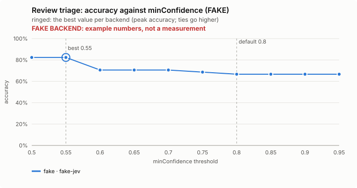
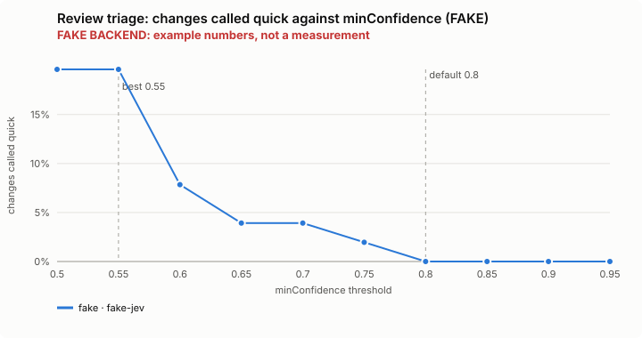
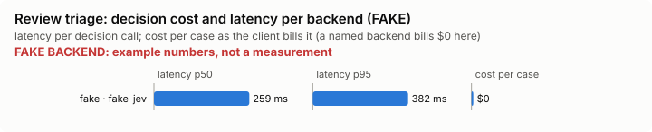

# Review triage: bench summary (FAKE backend)

> **FAKE BACKEND.** These numbers come from the bench's fake decision model and show only that the pipeline works. They say nothing about any model.

**Bench** (`bun src/bench/report.ts review-triage`; 0.11.0@c226712).

- **One case:** a change (a git diff) with its intent and the project's written rules, and whether it needs a full review or one quick pass is enough.
- **Measured:** whether Jev calls a change quick only when it is. Calling a change quick that needs a full review skips the review: that is the costly mistake. Calling a quick one full only costs time.
- **The setting:** how sure Jev must be, on every one of seven questions, that nothing is wrong before the change is called quick. Higher means fewer quick calls. (`minConfidence`, default 0.8)

**Compared with plain Claude Code: not yet.** No task-level run of this feature (a real Claude Code session with it off, then on, on the same task) has been made.

**Decision level.** Jev answers each case by itself, and the bench replays its answers at every value of `minConfidence`. Best = where accuracy peaks; a tie goes to the higher value: a higher bar answers quick less often, and a full review costs only time; a wrongly quick one skips a review.

**What this means.** At the default 0.8, Jev makes the right quick or full call on 66.7% of the 51 changes; at the best value found, 0.55, the same score is 82.4%. The shipped default (0.8) is not the best value found (0.55). Not yet changed.

| backend · model | cases | best | accuracy | precision | recall | F1 | changes called quick | full skipped | p50 | p95 | cost/case |
|---|---|---|---|---|---|---|---|---|---|---|---|
| fake · fake-jev | 51 | 0.55 | 82.4% | 90.0% | 52.9% | 66.7% | 19.6% | 1 | 259 ms | 382 ms | $0 |

- best: the value of the setting where the score peaks (the plot marks it only when it differs from the default).
- accuracy: the share of items where acting or not acting matched the label.
- precision: when the feature acts, how often acting was right.
- recall: of what it should have acted on, how much it did.
- F1: precision and recall in one number.
- changes called quick: the share of items the feature acts on, at the best value.
- full skipped: changes that needed a full review but were called quick.
- p50, p95: how long a decision call took (the middle one, and the slow end); cost/case: what the decision calls cost per case.

Best per backend:

- fake · fake-jev: minConfidence 0.55 (accuracy 82.4%; default 0.8: 66.7%)

