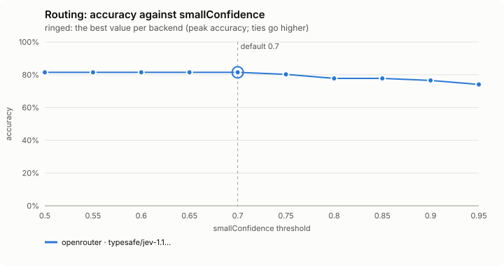
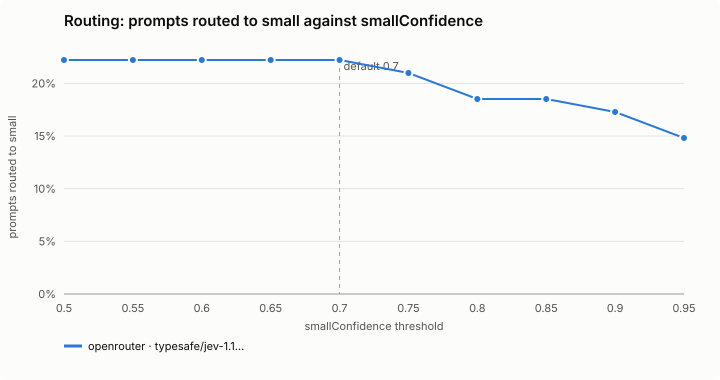
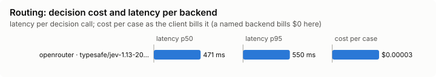

# Routing

Picks each turn's model and effort from the decision model's reading of the prompt.

Mode: `on` or `off` (no shadow). Default: `off`. The older *Routing* field in `/config` still works when no file sets this feature.

## What it decides

The turn's lane: small, medium, high or escalate. The lane sets the effort of every step of the turn, and its model while the context is small.

| Lane | Model | Effort |
|---|---|---|
| small | haiku | low |
| medium | sonnet | medium |
| high | opus | medium |
| escalate | opus | high |

Haiku is sent no effort. A `lanes.json` (in `~/.config/jev/`, or the shared one) can change a lane's model or effort. Subagents keep the model their definition names.

## When it runs

Once per turn, on the first step of the main thread, from the prompt read at submit. An empty prompt, or one that starts with `/`, is not classified. A short follow-up with no new text keeps the session's last lane.

## How it decides

The lane is Jev's reading of the prompt, laid under the session rules.

**The lane policy** (shipped with the mod, tuned on Jev 1.13; a backend's own copy in `~/.config/jev/backends/<name>/policies/lane.json`, or a local override at `~/.config/jev/policies/lane.json`, wins over it). One request asks three questions of the prompt: which lane is the smallest that would finish the work first try (or *other*: not work a model should start on), whether it is security-sensitive, and whether it is underspecified. Then:

- *other* with confidence 0.5 or more: keep the current model.
- *escalate* with confidence 0.6 or more: escalate.
- *high*, or *escalate* below 0.6, or security-sensitive at 0.7 or more, or *medium* below 0.5: high.
- *small* with confidence 0.7 or more, security-sensitive below 0.3 and underspecified below 0.5: small.
- Anything else: medium.

Two pre-rules run first, without asking Jev. `person_named_model`: a model you chose with `/model` (or the picker) holds for the session, Jev not asked, until you choose Default again; a model set at launch (`--model`, settings) is routed as usual. `prior_failed_attempts`: a second correction in a row starts at escalate. The policy's third pre-rule, `security_paths`, never fires here: a prompt gives no paths to check.

**The session rules** (`rules.ts`), within 30 minutes of the previous turn:

- A follow-up steps down one lane at most.
- A correction ("that's wrong", "try again", "still failing", ...) holds the previous lane or raises it, and a second correction in a row starts at escalate.
- Jev's own lane wins whenever it is higher.
- Outside the window, the turn stands on its own.

**The model switch.** Above 40k tokens of context the model only moves up: every switch re-reads the whole context uncached, worth paying once for a harder lane, never for a cheaper one.

## Settings

None. The lane table is `lanes.json`; the thresholds are the policy's (see above).

## Failing open, privacy and budget

No answer, a cool-off, private mode, the daily budget, no policy (or an override that does not lint), or a prompt that is empty or a command: the turn runs exactly as Claude Code sends it, and the band says so. The request has 4 seconds in all, retries included.

When Jev's version is not the one the policy was tuned on, the turn is not routed and the band says so (`not routed · Jev 1.14 ≠ tuned 1.13`). A named backend the policy was not tuned for is routed anyway, and the band reads `untuned`.

The prompt is redacted before it is sent.

## Limits

- The lane policy's `security_paths` pre-rule never fires: a prompt gives no paths to check.
- A model chosen with `/model` is never overridden, even by a harder prompt.
- The thresholds were measured on Jev; another backend's confidences are not the same numbers (see *Decision backends* in the main README).

## Benchmarks

<!-- bench:start -->
**Bench** (`bun src/bench/report.ts routing`; 0.11.0@14f7f68).

- **One case:** a prompt a person might type to Claude Code, and the lane (small, medium, high, escalate) the lane policy says suits it.
- **Measured:** whether Jev routes the prompt to exactly that lane. Too low a lane gives the work a cheaper model than it needs; too high wastes money.
- **The setting:** how sure Jev must be that a prompt is simple before it goes to the cheapest model. Higher sends fewer prompts there. (`smallConfidence`, default 0.7)

**Compared with plain Claude Code: not yet.** No task-level run of this feature (a real Claude Code session with it off, then on, on the same task) has been made.

**Decision level.** Jev answers each case by itself, and the bench replays its answers at every value of `smallConfidence`. Best = where accuracy peaks; a tie goes to the higher value: a higher bar sends fewer prompts to the cheapest model; the cost of a miss is a small model on work that needed more.

**What this means.** At the default 0.7, Jev picks the exact lane on 81.5% of the 81 prompts. No value in the sweep does better, so the default stays.

| backend · model | cases | best | accuracy | precision | recall | F1 | prompts routed to small | under-routed | over-routed | not routed | effort right | p50 | p95 | cost/case |
|---|---|---|---|---|---|---|---|---|---|---|---|---|---|---|
| openrouter · typesafe/jev-1.13-20260917 | 81 | 0.7 | 81.5% | 100.0% | 75.0% | 85.7% | 22.2% | 0.082 | 0.096 | 0.025 | 0.863 | 471 ms | 550 ms | $0.00003 |

- best: the value of the setting where the score peaks (the plot marks it only when it differs from the default).
- accuracy: the share of items where acting or not acting matched the label.
- precision: when the feature acts, how often acting was right.
- recall: of what it should have acted on, how much it did.
- F1: precision and recall in one number.
- prompts routed to small: the share of items the feature acts on, at the best value.
- under-routed: an extra measure, at the best value.
- over-routed: an extra measure, at the best value.
- not routed: an extra measure, at the best value.
- effort right: an extra measure, at the best value.
- p50, p95: how long a decision call took (the middle one, and the slow end); cost/case: what the decision calls cost per case.

Best per backend:

- openrouter · typesafe/jev-1.13-20260917: smallConfidence 0.7 (accuracy 81.5%; default 0.7: 81.5%)
<!-- bench:end -->
