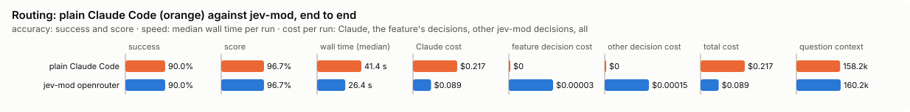

# Routing

Picks each turn's model and effort from the decision model's reading of the prompt.

Mode: `on` or `off` (no shadow). Default: `off`. The older *Routing* field in `/config` still works when no file sets this feature.

## What it decides

The turn's lane: small, medium, high or escalate. The lane sets the effort of every step of the turn, and its model while the context is small.

| Lane | Model | Effort |
|---|---|---|
| small | haiku | low |
| medium | sonnet | medium |
| high | opus | medium |
| escalate | opus | high |

Haiku is sent no effort. A `lanes.json` (in `~/.config/jev/`, or the shared one) can change a lane's model or effort. Subagents keep the model their definition names.

## When it runs

Once per turn, on the first step of the main thread, from the prompt read at submit. An empty prompt, or one that starts with `/`, is not classified. A short follow-up with no new text keeps the session's last lane.

## How it decides

The lane is Jev's reading of the prompt, laid under the session rules.

**The lane policy** (shipped with the mod, tuned on Jev 1.13; a backend's own copy in `~/.config/jev/backends/<name>/policies/lane.json`, or a local override at `~/.config/jev/policies/lane.json`, wins over it). One request asks three questions of the prompt: which lane is the smallest that would finish the work first try (or *other*: not work a model should start on), whether it is security-sensitive, and whether it is underspecified. Then:

- *other* with confidence 0.5 or more: keep the current model.
- *escalate* with confidence 0.6 or more: escalate.
- *high*, or *escalate* below 0.6, or security-sensitive at 0.7 or more, or *medium* below 0.5: high.
- *small* with confidence 0.7 or more, security-sensitive below 0.3 and underspecified below 0.5: small.
- Anything else: medium.

Two pre-rules run first, without asking Jev. `person_named_model`: a model you chose with `/model` (or the picker) holds for the session, Jev not asked, until you choose Default again; a model set at launch (`--model`, settings) is routed as usual. `prior_failed_attempts`: a second correction in a row starts at escalate. The policy's third pre-rule, `security_paths`, never fires here: a prompt gives no paths to check.

**The session rules** (`rules.ts`), within 30 minutes of the previous turn:

- A follow-up steps down one lane at most.
- A correction ("that's wrong", "try again", "still failing", ...) holds the previous lane or raises it, and a second correction in a row starts at escalate.
- Jev's own lane wins whenever it is higher.
- Outside the window, the turn stands on its own.

**The model switch.** Above 40k tokens of context the model only moves up: every switch re-reads the whole context uncached, worth paying once for a harder lane, never for a cheaper one.

## Settings

None. The lane table is `lanes.json`; the thresholds are the policy's (see above).

## Failing open, privacy and budget

No answer, a cool-off, private mode, the daily budget, no policy (or an override that does not lint), or a prompt that is empty or a command: the turn runs exactly as Claude Code sends it, and the band says so. The request has 4 seconds in all, retries included.

When Jev's version is not the one the policy was tuned on, the turn is not routed and the band says so (`not routed · Jev 1.14 ≠ tuned 1.13`). A named backend the policy was not tuned for is routed anyway, and the band reads `untuned`.

The prompt is redacted before it is sent.

## Limits

- The lane policy's `security_paths` pre-rule never fires: a prompt gives no paths to check.
- A model chosen with `/model` is never overridden, even by a harder prompt.
- The thresholds were measured on Jev; another backend's confidences are not the same numbers (see *Decision backends* in the main README).

## Benchmarks

<!-- bench:start -->
**Bench** (`bun src/bench/report.ts routing`; 0.11.0@14f7f68, 0.12.0@55065cf).

- **One case:** a prompt a person might type to Claude Code, and the lane (small, medium, high, escalate) the lane policy says suits it.
- **Measured:** whether Jev routes the prompt to exactly that lane. Too low a lane gives the work a cheaper model than it needs; too high wastes money.
- **The setting:** how sure Jev must be that a prompt is simple before it goes to the cheapest model. Higher sends fewer prompts there. (`smallConfidence`, default 0.7)

**Compared with plain Claude Code:**

| arm | runs | success | mean score | median time | total time | Claude cost | feature decision cost | other jev-mod decision cost | total cost |
|---|---|---|---|---|---|---|---|---|---|
| plain Claude Code | 10 | 90.0% | 96.7% | 41.4 s | 358.7 s | $0.217 | $0 | $0 | $0.217 |
| jev-mod openrouter | 10 | 90.0% | 96.7% | 26.4 s | 260.2 s | $0.089 | $0.00003 | $0.00015 | $0.089 |

- success: the share of scored runs the checker marked right; mean score: its partial credit (the share of questions answered right, say).
- median time: over scored runs; total time: every run of the arm, failed ones too.
- costs are per scored run. Feature decision cost: what routing's own decisions cost; other jev-mod decision cost: what other jev-mod features still asked in the arm (a protective feature the bench may not switch off, as the person has it). Total cost is Claude plus both. A failed run is never scored.
- plain Claude Code runs with jev-mod switched off whole, so it makes no decisions; a plain run that shows any is an error (`decisions_in_plain_arm`). Runs from jev-mod 0.12.0 and before switched off only the features that change what the model sees.

- jev-mod openrouter: right on 90.0% (plain Claude Code 90.0%) of runs, median 26.4 s (plain Claude Code 41.4 s), $0.089 (plain Claude Code $0.217) per run (Claude $0.089, routing's decisions $0.00003, other jev-mod decisions $0.00015).

| arm | question context | kept / dropped | Claude tokens |
|---|---|---|---|
| plain Claude Code | 158.2k | – | 161851 |
| jev-mod openrouter | 160.2k | – | 163001 |

- question context: what the last step read, in tokens (a smaller one is a compaction that worked); kept / dropped: messages the compaction kept and dropped, of those before it.

Spend in all: $3.055 Claude; $0.00181 decisions. A failed run is never scored, but its spend counts here.

**By difficulty**, and which models Claude's spend went to:

| difficulty | arm | success | Claude $/task | decision $/task | total $/task | wall s/task | Claude spend by model |
|---|---|---|---|---|---|---|---|
| trivial | claude | 4/4 | $0.116 | $0.00 | $0.116 | 14 | opus 100% |
| trivial | jev-mod openrouter | 4/4 | $0.058 | $0.00010 | $0.058 | 18 | sonnet 54%, haiku 46% |
| medium | claude | 2/3 | $0.298 | $0.00 | $0.298 | 56 | opus 100% |
| medium | jev-mod openrouter | 2/3 | $0.124 | $0.00021 | $0.124 | 36 | sonnet 100% |
| hard | claude | 3/3 | $0.270 | $0.00 | $0.270 | 45 | opus 100% |
| hard | jev-mod openrouter | 3/3 | $0.094 | $0.00026 | $0.094 | 26 | sonnet 100% |
| all | claude | 9/10 | $0.217 | $0.00 | $0.217 | 36 | opus 100% |
| all | jev-mod openrouter | 9/10 | $0.089 | $0.00018 | $0.089 | 26 | sonnet 88%, haiku 12% |

| case | difficulty | arm | success | score | Claude $ | decision $ | wall s | models |
|---|---|---|---|---|---|---|---|---|
| typo-message | trivial | claude | yes | 1.00 | $0.095 | $0.00 | 11 | opus |
| typo-message | trivial | jev-mod openrouter | yes | 1.00 | $0.055 | $0.00017 | 17 | haiku |
| rename-function | trivial | claude | yes | 1.00 | $0.161 | $0.00 | 21 | opus |
| rename-function | trivial | jev-mod openrouter | yes | 1.00 | $0.077 | $0.00003 | 17 | sonnet |
| lb-conversion | trivial | claude | yes | 1.00 | $0.113 | $0.00 | 14 | opus |
| lb-conversion | trivial | jev-mod openrouter | yes | 1.00 | $0.053 | $0.00016 | 31 | haiku |
| lookup-quote | trivial | claude | yes | 1.00 | $0.095 | $0.00 | 10 | opus |
| lookup-quote | trivial | jev-mod openrouter | yes | 1.00 | $0.047 | $0.00003 | 8 | sonnet |
| express-option | medium | claude | no | 0.67 | $0.267 | $0.00 | 51 | opus |
| express-option | medium | jev-mod openrouter | no | 0.67 | $0.136 | $0.00030 | 41 | sonnet |
| report-by-zone | medium | claude | yes | 1.00 | $0.226 | $0.00 | 44 | opus |
| report-by-zone | medium | jev-mod openrouter | yes | 1.00 | $0.140 | $0.00017 | 41 | sonnet |
| public-holidays | medium | claude | yes | 1.00 | $0.401 | $0.00 | 73 | opus |
| public-holidays | medium | jev-mod openrouter | yes | 1.00 | $0.097 | $0.00017 | 27 | sonnet |
| gst-rounding | hard | claude | yes | 1.00 | $0.252 | $0.00 | 41 | opus |
| gst-rounding | hard | jev-mod openrouter | yes | 1.00 | $0.091 | $0.00018 | 24 | sonnet |
| weekend-eta | hard | claude | yes | 1.00 | $0.287 | $0.00 | 46 | opus |
| weekend-eta | hard | jev-mod openrouter | yes | 1.00 | $0.097 | $0.00034 | 28 | sonnet |
| report-total | hard | claude | yes | 1.00 | $0.272 | $0.00 | 47 | opus |
| report-total | hard | jev-mod openrouter | yes | 1.00 | $0.094 | $0.00026 | 26 | sonnet |

**Decision level.** Jev answers each case by itself, and the bench replays its answers at every value of `smallConfidence`. Best = where accuracy peaks; a tie goes to the higher value: a higher bar sends fewer prompts to the cheapest model; the cost of a miss is a small model on work that needed more.

**What this means.** At the default 0.7, Jev picks the exact lane on 81.5% of the 81 prompts. No value in the sweep does better, so the default stays.

| backend · model | cases | best | accuracy | precision | recall | F1 | prompts routed to small | under-routed | over-routed | not routed | effort right | p50 | p95 | cost/case |
|---|---|---|---|---|---|---|---|---|---|---|---|---|---|---|
| openrouter · typesafe/jev-1.13-20260917 | 81 | 0.7 | 81.5% | 100.0% | 75.0% | 85.7% | 22.2% | 0.082 | 0.096 | 0.025 | 0.863 | 471 ms | 550 ms | $0.00003 |

- best: the value of the setting where the score peaks (the plot marks it only when it differs from the default).
- accuracy: the share of items where acting or not acting matched the label.
- precision: when the feature acts, how often acting was right.
- recall: of what it should have acted on, how much it did.
- F1: precision and recall in one number.
- prompts routed to small: the share of items the feature acts on, at the best value.
- under-routed: an extra measure, at the best value.
- over-routed: an extra measure, at the best value.
- not routed: an extra measure, at the best value.
- effort right: an extra measure, at the best value.
- p50, p95: how long a decision call took (the middle one, and the slow end); cost/case: what the decision calls cost per case.

Best per backend:

- openrouter · typesafe/jev-1.13-20260917: smallConfidence 0.7 (accuracy 81.5%; default 0.7: 81.5%)
<!-- bench:end -->

### Task level: real coding prompts, routed or not

`bench/task.ts`: ten prompts a person would type in parcelkit (`bench/task-fixture/`), a small NZ
courier codebase in Python with its own unittest suite. Four are trivial (fix a typo in an error
message, rename a function everywhere, fix a one-line unit conversion, look up a price without
changing anything), three medium (an `--express` option, a `--by-zone` report, public holidays in
delivery estimates: two or three files and tests each) and three hard (GST a cent off from
banker's rounding in two places, weekend and after-cutoff ETAs wrong from a bug in `dates.py` and
a UTC conversion in `cli.py`, a report total that drops leading zeros and ignores dimensions).

One task is one `claude -p` with the prompt, in a fresh copy of the project, once per arm:

- **plain Claude Code**: routing off, so every turn runs on Claude Code's default model and
  effort. On the machine the bench was built on that is `claude-opus-5-5` (each row records the
  model that answered), so this arm is also the "always the strongest model" reference; a second
  arm pinned to Opus would be the same arm.
- **jev-mod**: routing on; Jev's lane for the prompt picks the model and effort.

A task succeeds when the project's own tests pass and so does its hidden check
(`bench/task-checks/<id>.py`, run after the arm, never seen by it): exact CLI output, exact
values from the API, no old name left, nothing changed for the lookup. Per task the row records
success and the share of checks passed, the wall time, Claude's cost, the models that answered
and what each cost (`claude_models`, from `modelUsage`), and the decision model's cost: routing's
one request apart from any other jev-mod feature's (a protective one stays as the person has it in
the jev-mod arm; plain Claude Code runs with jev-mod off whole). `bun src/bench/report.ts routing`
adds, under the comparison, success, cost and wall time by difficulty and arm, and where each arm's
Claude spend went by model, so the table shows where routing saves money and whether it loses
accuracy on hard work.

Routing does take effect headless: the mod's `turn.step` hook runs under `claude -p`. In the
smoke run (one trivial case, 2026-10-11) the routed arm's `modelUsage` named only
`claude-haiku-4-5-20251001` and the plain arm's only `claude-opus-5-5`; both fixed the bug, $0.10
against $0.27 of Claude and 28 s against 31 s, for $0.00003 of routing decision.

`bun src/features/routing/bench/task-selfcheck.ts` checks the bench for free: each hidden check
fails on the fixture as shipped and passes on a known-good fix, and the task runner goes end to
end on a fake `claude` (rows in `bench/fake/`).
