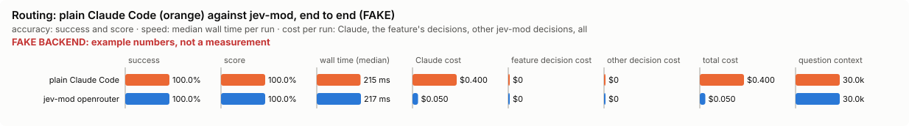

# Routing: bench summary (FAKE backend)

> **FAKE BACKEND.** These numbers come from the bench's fake decision model and show only that the pipeline works. They say nothing about any model.

**Bench** (`bun src/bench/report.ts routing`; 0.11.0@c226712, 0.12.0@fake).

- **One case:** a prompt a person might type to Claude Code, and the lane (small, medium, high, escalate) the lane policy says suits it.
- **Measured:** whether Jev routes the prompt to exactly that lane. Too low a lane gives the work a cheaper model than it needs; too high wastes money.
- **The setting:** how sure Jev must be that a prompt is simple before it goes to the cheapest model. Higher sends fewer prompts there. (`smallConfidence`, default 0.7)

**Compared with plain Claude Code:**

| arm | runs | success | mean score | median time | total time | Claude cost | feature decision cost | other jev-mod decision cost | total cost |
|---|---|---|---|---|---|---|---|---|---|
| plain Claude Code | 10 | 100.0% | 100.0% | 215 ms | 2162 ms | $0.400 | $0 | $0 | $0.400 |
| jev-mod openrouter | 10 | 100.0% | 100.0% | 217 ms | 2198 ms | $0.050 | $0 | $0 | $0.050 |

- success: the share of scored runs the checker marked right; mean score: its partial credit (the share of questions answered right, say).
- median time: over scored runs; total time: every run of the arm, failed ones too.
- costs are per scored run. Feature decision cost: what routing's own decisions cost; other jev-mod decision cost: what other jev-mod features still asked in the arm (a protective feature the bench may not switch off, as the person has it). Total cost is Claude plus both. A failed run is never scored.
- plain Claude Code runs with jev-mod switched off whole, so it makes no decisions; a plain run that shows any is an error (`decisions_in_plain_arm`). Runs from jev-mod 0.12.0 and before switched off only the features that change what the model sees.

- jev-mod openrouter: right on 100.0% (plain Claude Code 100.0%) of runs, median 217 ms (plain Claude Code 215 ms), $0.050 (plain Claude Code $0.400) per run (Claude $0.050, routing's decisions $0, other jev-mod decisions $0).

| arm | question context | kept / dropped | Claude tokens |
|---|---|---|---|
| plain Claude Code | 30.0k | – | 30030 |
| jev-mod openrouter | 30.0k | – | 30030 |

- question context: what the last step read, in tokens (a smaller one is a compaction that worked); kept / dropped: messages the compaction kept and dropped, of those before it.

Spend in all: $4.500 Claude; $0 decisions. A failed run is never scored, but its spend counts here.

**By difficulty**, and which models Claude's spend went to:

| difficulty | arm | success | Claude $/task | decision $/task | total $/task | wall s/task | Claude spend by model |
|---|---|---|---|---|---|---|---|
| trivial | claude | 4/4 | $0.400 | $0.00 | $0.400 | 0 | opus 100% |
| trivial | jev-mod openrouter | 4/4 | $0.050 | $0.00 | $0.050 | 0 | haiku 100% |
| medium | claude | 3/3 | $0.400 | $0.00 | $0.400 | 0 | opus 100% |
| medium | jev-mod openrouter | 3/3 | $0.050 | $0.00 | $0.050 | 0 | haiku 100% |
| hard | claude | 3/3 | $0.400 | $0.00 | $0.400 | 0 | opus 100% |
| hard | jev-mod openrouter | 3/3 | $0.050 | $0.00 | $0.050 | 0 | haiku 100% |
| all | claude | 10/10 | $0.400 | $0.00 | $0.400 | 0 | opus 100% |
| all | jev-mod openrouter | 10/10 | $0.050 | $0.00 | $0.050 | 0 | haiku 100% |

| case | difficulty | arm | success | score | Claude $ | decision $ | wall s | models |
|---|---|---|---|---|---|---|---|---|
| typo-message | trivial | claude | yes | 1.00 | $0.400 | $0.00 | 0 | opus |
| typo-message | trivial | jev-mod openrouter | yes | 1.00 | $0.050 | $0.00 | 0 | haiku |
| rename-function | trivial | claude | yes | 1.00 | $0.400 | $0.00 | 0 | opus |
| rename-function | trivial | jev-mod openrouter | yes | 1.00 | $0.050 | $0.00 | 0 | haiku |
| lb-conversion | trivial | claude | yes | 1.00 | $0.400 | $0.00 | 0 | opus |
| lb-conversion | trivial | jev-mod openrouter | yes | 1.00 | $0.050 | $0.00 | 0 | haiku |
| lookup-quote | trivial | claude | yes | 1.00 | $0.400 | $0.00 | 0 | opus |
| lookup-quote | trivial | jev-mod openrouter | yes | 1.00 | $0.050 | $0.00 | 0 | haiku |
| express-option | medium | claude | yes | 1.00 | $0.400 | $0.00 | 0 | opus |
| express-option | medium | jev-mod openrouter | yes | 1.00 | $0.050 | $0.00 | 0 | haiku |
| report-by-zone | medium | claude | yes | 1.00 | $0.400 | $0.00 | 0 | opus |
| report-by-zone | medium | jev-mod openrouter | yes | 1.00 | $0.050 | $0.00 | 0 | haiku |
| public-holidays | medium | claude | yes | 1.00 | $0.400 | $0.00 | 0 | opus |
| public-holidays | medium | jev-mod openrouter | yes | 1.00 | $0.050 | $0.00 | 0 | haiku |
| gst-rounding | hard | claude | yes | 1.00 | $0.400 | $0.00 | 0 | opus |
| gst-rounding | hard | jev-mod openrouter | yes | 1.00 | $0.050 | $0.00 | 0 | haiku |
| weekend-eta | hard | claude | yes | 1.00 | $0.400 | $0.00 | 0 | opus |
| weekend-eta | hard | jev-mod openrouter | yes | 1.00 | $0.050 | $0.00 | 0 | haiku |
| report-total | hard | claude | yes | 1.00 | $0.400 | $0.00 | 0 | opus |
| report-total | hard | jev-mod openrouter | yes | 1.00 | $0.050 | $0.00 | 0 | haiku |

**Decision level.** Jev answers each case by itself, and the bench replays its answers at every value of `smallConfidence`. Best = where accuracy peaks; a tie goes to the higher value: a higher bar sends fewer prompts to the cheapest model; the cost of a miss is a small model on work that needed more.

**What this means.** At the default 0.7, Jev picks the exact lane on 58.0% of the 81 prompts; at the best value found, 0.5, the same score is 60.5%. The shipped default (0.7) is not the best value found (0.5). Not yet changed.

| backend · model | cases | best | accuracy | precision | recall | F1 | prompts routed to small | under-routed | over-routed | not routed | effort right | p50 | p95 | cost/case |
|---|---|---|---|---|---|---|---|---|---|---|---|---|---|---|
| fake · fake-jev | 81 | 0.5 | 60.5% | 100.0% | 20.8% | 34.5% | 6.2% | 0.054 | 0.365 | 0.012 | 0.689 | 219 ms | 391 ms | $0 |

- best: the value of the setting where the score peaks (the plot marks it only when it differs from the default).
- accuracy: the share of items where acting or not acting matched the label.
- precision: when the feature acts, how often acting was right.
- recall: of what it should have acted on, how much it did.
- F1: precision and recall in one number.
- prompts routed to small: the share of items the feature acts on, at the best value.
- under-routed: an extra measure, at the best value.
- over-routed: an extra measure, at the best value.
- not routed: an extra measure, at the best value.
- effort right: an extra measure, at the best value.
- p50, p95: how long a decision call took (the middle one, and the slow end); cost/case: what the decision calls cost per case.

Best per backend:

- fake · fake-jev: smallConfidence 0.5 (accuracy 60.5%; default 0.7: 58.0%)

