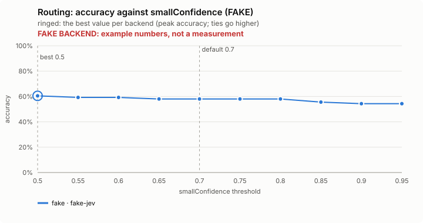
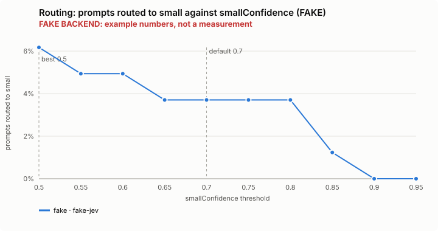
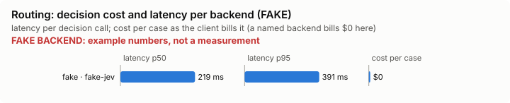

# Routing: bench summary (FAKE backend)

> **FAKE BACKEND.** These numbers come from the bench's fake decision model and show only that the pipeline works. They say nothing about any model.

**Bench** (`bun src/bench/report.ts routing`; 0.11.0@c226712).

- **One case:** a prompt a person might type to Claude Code, and the lane (small, medium, high, escalate) the lane policy says suits it.
- **Measured:** whether Jev routes the prompt to exactly that lane. Too low a lane gives the work a cheaper model than it needs; too high wastes money.
- **The setting:** how sure Jev must be that a prompt is simple before it goes to the cheapest model. Higher sends fewer prompts there. (`smallConfidence`, default 0.7)

**Compared with plain Claude Code: not yet.** No task-level run of this feature (a real Claude Code session with it off, then on, on the same task) has been made.

**Decision level.** Jev answers each case by itself, and the bench replays its answers at every value of `smallConfidence`. Best = where accuracy peaks; a tie goes to the higher value: a higher bar sends fewer prompts to the cheapest model; the cost of a miss is a small model on work that needed more.

**What this means.** At the default 0.7, Jev picks the exact lane on 58.0% of the 81 prompts; at the best value found, 0.5, the same score is 60.5%. The shipped default (0.7) is not the best value found (0.5). Not yet changed.

| backend · model | cases | best | accuracy | precision | recall | F1 | prompts routed to small | under-routed | over-routed | not routed | effort right | p50 | p95 | cost/case |
|---|---|---|---|---|---|---|---|---|---|---|---|---|---|---|
| fake · fake-jev | 81 | 0.5 | 60.5% | 100.0% | 20.8% | 34.5% | 6.2% | 0.054 | 0.365 | 0.012 | 0.689 | 219 ms | 391 ms | $0 |

- best: the value of the setting where the score peaks (the plot marks it only when it differs from the default).
- accuracy: the share of items where acting or not acting matched the label.
- precision: when the feature acts, how often acting was right.
- recall: of what it should have acted on, how much it did.
- F1: precision and recall in one number.
- prompts routed to small: the share of items the feature acts on, at the best value.
- under-routed: an extra measure, at the best value.
- over-routed: an extra measure, at the best value.
- not routed: an extra measure, at the best value.
- effort right: an extra measure, at the best value.
- p50, p95: how long a decision call took (the middle one, and the slow end); cost/case: what the decision calls cost per case.

Best per backend:

- fake · fake-jev: smallConfidence 0.5 (accuracy 60.5%; default 0.7: 58.0%)

