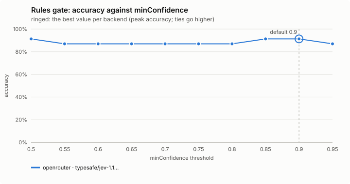
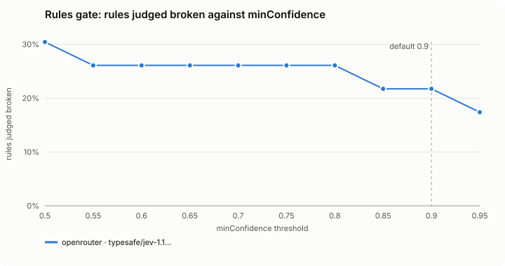
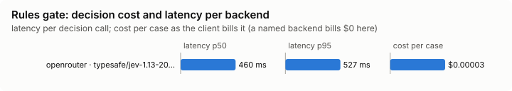

# Rules gate (`rules-gate`)

Refuses an edit the decision model judges breaks one of the project's written rules.

Modes: `on`, `shadow`, `off`. Default: `off`. It guards you, so a project's file may only make its mode stricter, and its settings come from your file alone.

## What it decides

Whether a change to a file inside the project breaks one of the written rules that apply to that file. In `on`, a rule judged broken with confidence `minConfidence` (0.8) or more refuses the edit. The agent is told which rule, quoted with its file, and asked to fix the change or tell you why the rule should not apply. The refusal is the error the model reads.

## When it runs

Before Write, Edit, MultiEdit or NotebookEdit changes a file inside the project. It sits on the same permission decision as the [tool-call gate](../tool-gate/README.md): a deny already made stands; an edit Claude Code would allow or ask you about may be refused. Edits outside the project are the tool-call gate's. Subagents' edits are judged too unless `subagents` is false.

## How it decides

**The rules.** List items and short directives in `CLAUDE.md`, `AGENTS.md` and `CLAUDE.local.md` from the project root down to the file's folder (and `.claude/CLAUDE.md` at the root), and `.claude/rules/*.md` whose `paths:` match the file. A rule is a list item, a numbered item, or a short line that reads as a directive; headings (kept as each rule's context), code blocks, tables and long prose are not rules. Parsed rule files are cached by mtime.

A rule file it reads, for example `.claude/rules/tests.md`:

```markdown
---
paths:
  - "**/*.test.ts"
---
# Tests

- Never touch the real `~/.config/jev-mod/config.json`; use a fake IO.
- Use a fake backend; no test needs a real key.
- Name each test after the behaviour it checks.
```

**What is sent.** The file's path in the project, the change, and one yes/no question per rule ("Does this change break this rule?"). The change is an Edit's old and new text, a MultiEdit's every edit, a Write's changed lines against the file, or the whole of a new file; redacted, about `maxChangeChars`. Past `maxRules`, the rules whose words match the file's path and the change's identifiers are kept, nearer files first.

**How it judges.** A change or a rule that only mentions a secret ("Never log API keys", `apiKey: config.apiKey`) is judged like any other; secret values in either (the literal after `password =` or `apiKey:`, a token, a bearer credential, a private key) are masked before anything is sent. A rule about other files or workflow steps (tests, a changelog, commits, reviews) is judged not broken by a single edit.

**Shadow.** The 0.8 threshold has not been checked against real answers yet: run it in `shadow` first. It counts `would-block`, `passed` and `skipped`, in the background, so no edit waits for it; `on` counts `blocked`.

## Settings

| Setting | Default | Range | What it does |
|---|---|---|---|
| `minConfidence` | 0.8 | 0.5-1 | How sure the decision model must be that a change breaks a rule for the edit to be refused. |
| `maxRules` | 25 | 5-60 | The most rules judged per edit; past it, those whose words match the file's path and the change are kept, nearer files first. |
| `timeoutMs` | 3000 | 1000-10000 | How long an edit waits for the decision before it goes on unjudged. |
| `maxChangeChars` | 6000 | 1000-20000 | About how many characters of the change are sent (redacted); a Write to an existing file sends the lines that differ. |
| `subagents` | true | true / false | true: a subagent's edits are judged as the agent's are. false: they go on unjudged. |

## Failing open, privacy and budget

No answer within `timeoutMs`, no key, private mode, a secret in the change, the daily budget or a backend cool-off: the edit goes on.

## Limits

- Only rules written in the files above; nothing is inferred.
- A rule about workflow (tests, changelog, commits, reviews) cannot be broken by one edit as far as the gate can tell.
- The threshold is untested against real answers.

## Benchmarks

<!-- bench:start -->
**Bench** (`bun src/bench/report.ts rules-gate`; 0.11.0@14f7f68). Threshold swept: `minConfidence` (today 0.8). Recommended = where accuracy peaks; a tie goes to the higher value: a higher bar refuses fewer edits, and the mod fails open: a doubtful edit goes on.





| backend · model | cases | recommended | accuracy | precision | recall | F1 | rules judged broken | p50 | p95 | cost/case |
|---|---|---|---|---|---|---|---|---|---|---|
| openrouter · typesafe/jev-1.13-20260917 | 8 | 0.9 | 91.3% | 100.0% | 71.4% | 83.3% | 21.7% | 460 ms | 527 ms | $0.00003 |

Recommended per backend:

- openrouter · typesafe/jev-1.13-20260917: minConfidence 0.9 (accuracy 91.3%; today's 0.8: 87.0%)
<!-- bench:end -->
