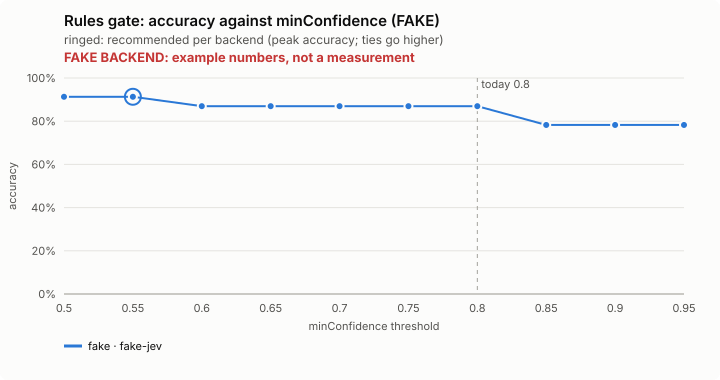
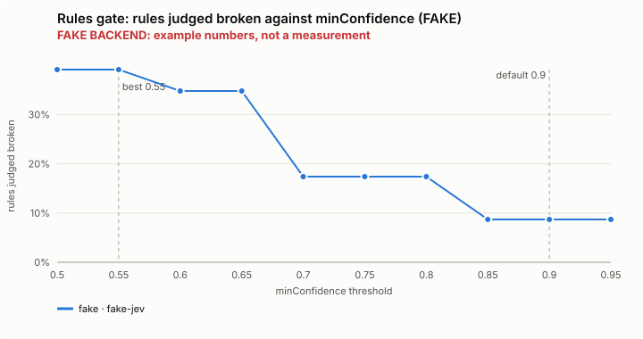
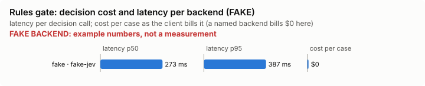

# Rules gate: bench summary (FAKE backend)

> **FAKE BACKEND.** These numbers come from the bench's fake decision model and show only that the pipeline works. They say nothing about any model.

**Bench** (`bun src/bench/report.ts rules-gate`; 0.10.0@f040686). Threshold swept: `minConfidence` (today 0.8). Recommended = where accuracy peaks; a tie goes to the higher value: a higher bar refuses fewer edits, and the mod fails open: a doubtful edit goes on.

| backend · model | cases | recommended | accuracy | precision | recall | F1 | rules judged broken | p50 | p95 | cost/case |
|---|---|---|---|---|---|---|---|---|---|---|
| fake · fake-jev | 8 | 0.55 | 91.3% | 77.8% | 100.0% | 87.5% | 39.1% | 273 ms | 387 ms | $0 |

Recommended per backend:

- fake · fake-jev: minConfidence 0.55 (accuracy 91.3%; today's 0.8: 87.0%)

