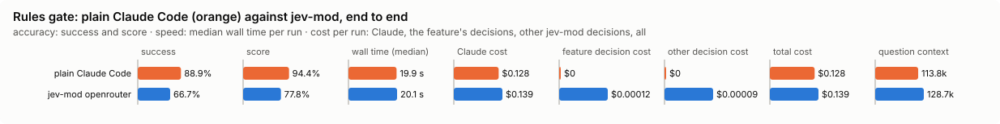

# Rules gate: bench summary

**Bench** (`bun src/bench/report.ts rules-gate`; 0.11.0@14f7f68, 0.12.0@55065cf).

- **One case:** an edit to a file in a project, with the written rules that apply to that file, and for each rule whether the edit breaks it.
- **Measured:** for each rule, whether Jev says broken when it is. Refusing an edit that breaks no rule is a wasted turn; letting a breaking one through is the miss.
- **The setting:** how sure Jev must be that a rule is broken before the edit is refused. Higher refuses fewer edits, and a doubtful one goes on. (`minConfidence`, default 0.9)

**Compared with plain Claude Code:**

| arm | runs | success | mean score | median time | total time | Claude cost | feature decision cost | other jev-mod decision cost | total cost |
|---|---|---|---|---|---|---|---|---|---|
| plain Claude Code | 9 | 88.9% | 94.4% | 19.9 s | 176.3 s | $0.128 | $0 | $0 | $0.128 |
| jev-mod openrouter | 9 | 66.7% | 77.8% | 20.1 s | 223.0 s | $0.139 | $0.00012 | $0.00009 | $0.139 |

- success: the share of scored runs the checker marked right; mean score: its partial credit (the share of questions answered right, say).
- median time: over scored runs; total time: every run of the arm, failed ones too.
- costs are per scored run. Feature decision cost: what rules-gate's own decisions cost; other jev-mod decision cost: what other jev-mod features still asked in the arm (a protective feature the bench may not switch off, as the person has it). Total cost is Claude plus both. A failed run is never scored.
- plain Claude Code runs with jev-mod switched off whole, so it makes no decisions; a plain run that shows any is an error (`decisions_in_plain_arm`). Runs from jev-mod 0.12.0 and before switched off only the features that change what the model sees.

- jev-mod openrouter: right on 66.7% (plain Claude Code 88.9%) of runs, median 20.1 s (plain Claude Code 19.9 s), $0.139 (plain Claude Code $0.128) per run (Claude $0.139, rules-gate's decisions $0.00012, other jev-mod decisions $0.00009).

| arm | question context | kept / dropped | Claude tokens |
|---|---|---|---|
| plain Claude Code | 113.8k | – | 115528 |
| jev-mod openrouter | 128.7k | – | 130725 |

- question context: what the last step read, in tokens (a smaller one is a compaction that worked); kept / dropped: messages the compaction kept and dropped, of those before it.

Spend in all: $2.403 Claude; $0.00186 decisions. A failed run is never scored, but its spend counts here.

**Decision level.** Jev answers each case by itself, and the bench replays its answers at every value of `minConfidence`. Best = where accuracy peaks; a tie goes to the higher value: a higher bar refuses fewer edits, and the mod fails open: a doubtful edit goes on.

**What this means.** At the default 0.9, Jev judges the rules right on 91.3% of the rule checks over 8 edits. No value in the sweep does better, so the default stays.

| backend · model | cases | best | accuracy | precision | recall | F1 | rules judged broken | p50 | p95 | cost/case |
|---|---|---|---|---|---|---|---|---|---|---|
| openrouter · typesafe/jev-1.13-20260917 | 8 | 0.9 | 91.3% | 100.0% | 71.4% | 83.3% | 21.7% | 460 ms | 527 ms | $0.00003 |

- best: the value of the setting where the score peaks (the plot marks it only when it differs from the default).
- accuracy: the share of items where acting or not acting matched the label.
- precision: when the feature acts, how often acting was right.
- recall: of what it should have acted on, how much it did.
- F1: precision and recall in one number.
- rules judged broken: the share of items the feature acts on, at the best value.
- p50, p95: how long a decision call took (the middle one, and the slow end); cost/case: what the decision calls cost per case.

Best per backend:

- openrouter · typesafe/jev-1.13-20260917: minConfidence 0.9 (accuracy 91.3%; default 0.9: 91.3%)

