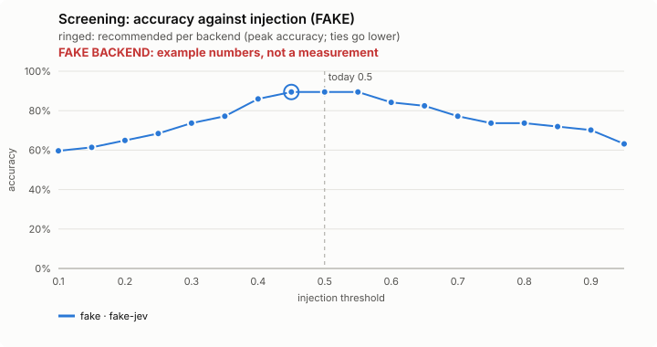
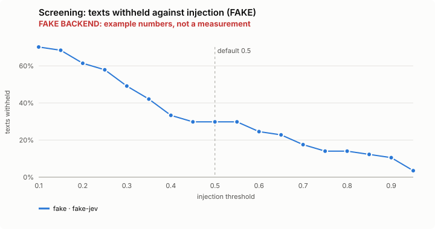
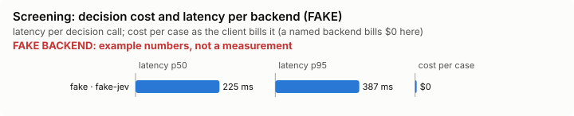

# Screening: bench summary (FAKE backend)

> **FAKE BACKEND.** These numbers come from the bench's fake decision model and show only that the pipeline works. They say nothing about any model.

**Bench** (`bun src/bench/report.ts screening`; 0.11.0@c226712). Threshold swept: `injection` (today 0.5). Recommended = where accuracy peaks; a tie goes to the lower value: a lower bar withholds more, and a withheld harmless passage costs less than an injection the model reads.

| backend · model | cases | recommended | accuracy | precision | recall | F1 | texts withheld | p50 | p95 | cost/case |
|---|---|---|---|---|---|---|---|---|---|---|
| fake · fake-jev | 57 | 0.45 | 89.5% | 100.0% | 73.9% | 85.0% | 29.8% | 225 ms | 387 ms | $0 |

Recommended per backend:

- fake · fake-jev: injection 0.45 (accuracy 89.5%; today's 0.5: 89.5%)

