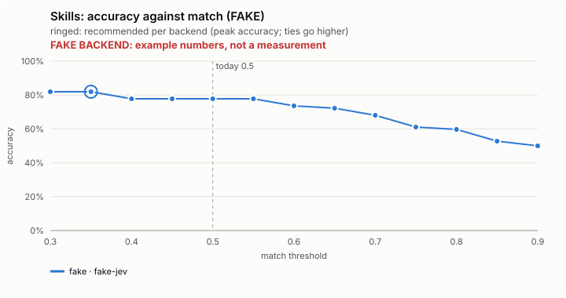
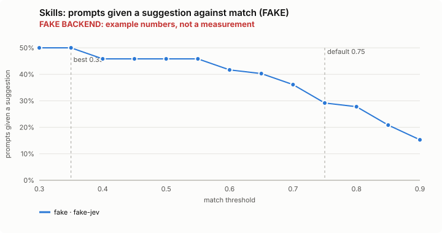
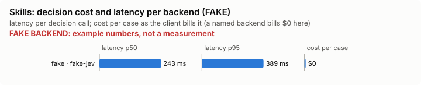

# Skills: bench summary (FAKE backend)

> **FAKE BACKEND.** These numbers come from the bench's fake decision model and show only that the pipeline works. They say nothing about any model.

**Bench** (`bun src/bench/report.ts skills`; 0.11.0@c226712).

- **One case:** a prompt a person might type, against a catalog of installed skills, and the skill that is the right procedure for it (or none).
- **Measured:** whether Jev suggests a skill only when its top pick is a right one. A wrong suggestion costs a detour and context; a missed one costs nothing the model would not have done anyway.
- **The setting:** how well the top skill must match the prompt before it is suggested. Higher suggests less often. (`match`, default 0.75)

**Compared with plain Claude Code: not yet.** No task-level run of this feature (a real Claude Code session with it off, then on, on the same task) has been made.

**Decision level.** Jev answers each case by itself, and the bench replays its answers at every value of `match`. Best = where accuracy peaks; a tie goes to the higher value: a higher bar suggests less often; a wrong suggestion costs a detour and context, a missed one costs nothing the model would not have done anyway.

**What this means.** At the default 0.75, Jev suggests the right skill, or none, on 61.1% of the 72 prompts; at the best value found, 0.35, the same score is 81.9%. The shipped default (0.75) is not the best value found (0.35). Not yet changed.

| backend · model | cases | best | accuracy | precision | recall | F1 | prompts given a suggestion | right skill first | wrong skill suggested | unneeded suggestion | p50 | p95 | cost/case |
|---|---|---|---|---|---|---|---|---|---|---|---|---|---|
| fake · fake-jev | 72 | 0.35 | 81.9% | 97.2% | 74.5% | 84.3% | 50.0% | 0.979 | 0.021 | 0 | 243 ms | 389 ms | $0 |

- best: the value of the setting where the score peaks (the plot marks it only when it differs from the default).
- accuracy: the share of items where acting or not acting matched the label.
- precision: when the feature acts, how often acting was right.
- recall: of what it should have acted on, how much it did.
- F1: precision and recall in one number.
- prompts given a suggestion: the share of items the feature acts on, at the best value.
- right skill first: an extra measure, at the best value.
- wrong skill suggested: an extra measure, at the best value.
- unneeded suggestion: an extra measure, at the best value.
- p50, p95: how long a decision call took (the middle one, and the slow end); cost/case: what the decision calls cost per case.

Best per backend:

- fake · fake-jev: match 0.35 (accuracy 81.9%; default 0.75: 61.1%)

