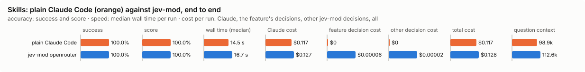

# Skills: bench summary

**Bench** (`bun src/bench/report.ts skills`; 0.11.0@14f7f68, 0.12.0@55065cf).

- **One case:** a prompt a person might type, against a catalog of installed skills, and the skill that is the right procedure for it (or none).
- **Measured:** whether Jev suggests a skill only when its top pick is a right one. A wrong suggestion costs a detour and context; a missed one costs nothing the model would not have done anyway.
- **The setting:** how well the top skill must match the prompt before it is suggested. Higher suggests less often. (`match`, default 0.75)

**Compared with plain Claude Code:**

| arm | runs | success | mean score | median time | total time | Claude cost | feature decision cost | other jev-mod decision cost | total cost |
|---|---|---|---|---|---|---|---|---|---|
| plain Claude Code | 10 | 100.0% | 100.0% | 14.5 s | 175.9 s | $0.117 | $0 | $0 | $0.117 |
| jev-mod openrouter | 10 | 100.0% | 100.0% | 16.7 s | 194.3 s | $0.127 | $0.00006 | $0.00002 | $0.128 |

- success: the share of scored runs the checker marked right; mean score: its partial credit (the share of questions answered right, say).
- median time: over scored runs; total time: every run of the arm, failed ones too.
- costs are per scored run. Feature decision cost: what skills's own decisions cost; other jev-mod decision cost: what other jev-mod features still asked in the arm (a protective feature the bench may not switch off, as the person has it). Total cost is Claude plus both. A failed run is never scored.
- plain Claude Code runs with jev-mod switched off whole, so it makes no decisions; a plain run that shows any is an error (`decisions_in_plain_arm`). Runs from jev-mod 0.12.0 and before switched off only the features that change what the model sees.

- jev-mod openrouter: right on 100.0% (plain Claude Code 100.0%) of runs, median 16.7 s (plain Claude Code 14.5 s), $0.128 (plain Claude Code $0.117) per run (Claude $0.127, skills's decisions $0.00006, other jev-mod decisions $0.00002).

| arm | question context | kept / dropped | Claude tokens |
|---|---|---|---|
| plain Claude Code | 98.9k | – | 100193 |
| jev-mod openrouter | 112.6k | – | 114148 |

- question context: what the last step read, in tokens (a smaller one is a compaction that worked); kept / dropped: messages the compaction kept and dropped, of those before it.

Spend in all: $2.443 Claude; $0.00089 decisions. A failed run is never scored, but its spend counts here.

**Decision level.** Jev answers each case by itself, and the bench replays its answers at every value of `match`. Best = where accuracy peaks; a tie goes to the higher value: a higher bar suggests less often; a wrong suggestion costs a detour and context, a missed one costs nothing the model would not have done anyway.

**What this means.** At the default 0.75, Jev suggests the right skill, or none, on 98.6% of the 72 prompts. No value in the sweep does better, so the default stays.

| backend · model | cases | best | accuracy | precision | recall | F1 | prompts given a suggestion | right skill first | wrong skill suggested | unneeded suggestion | p50 | p95 | cost/case |
|---|---|---|---|---|---|---|---|---|---|---|---|---|---|
| openrouter · typesafe/jev-1.13-20260917 | 72 | 0.75 | 98.6% | 98.0% | 100.0% | 99.0% | 68.1% | 1 | 0 | 0.042 | 468 ms | 584 ms | $0.00008 |

- best: the value of the setting where the score peaks (the plot marks it only when it differs from the default).
- accuracy: the share of items where acting or not acting matched the label.
- precision: when the feature acts, how often acting was right.
- recall: of what it should have acted on, how much it did.
- F1: precision and recall in one number.
- prompts given a suggestion: the share of items the feature acts on, at the best value.
- right skill first: an extra measure, at the best value.
- wrong skill suggested: an extra measure, at the best value.
- unneeded suggestion: an extra measure, at the best value.
- p50, p95: how long a decision call took (the middle one, and the slow end); cost/case: what the decision calls cost per case.

Best per backend:

- openrouter · typesafe/jev-1.13-20260917: match 0.75 (accuracy 98.6%; default 0.75: 98.6%)

