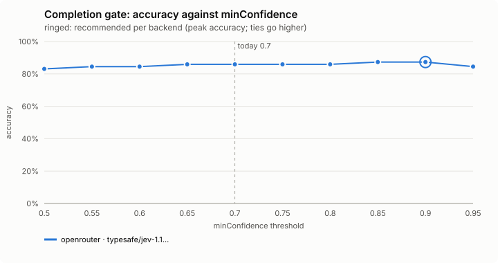
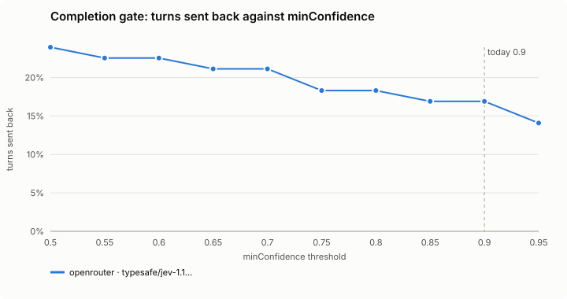
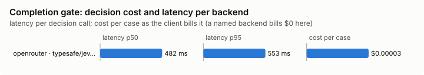

# Completion gate (`stop-gate`)

Checks that a turn claiming the work is done has the evidence to show it, and that it does not stop short of a step you asked for.

Modes: `on`, `shadow`, `off`. Default: `off`. It guards you, so a project's file may only make its mode stricter, and its settings come from your file alone.

## What it decides

Two things when the main agent ends a turn.

**Claims.** Whether the evidence shows the turn's weakest claim: *shown*, *not shown* (the evidence lacks it or contradicts it) or *could not tell* (evidence cut to fit, a claim outside the session's visible commands, or a low-confidence answer). Plans, conditionals and questions are not claims, nor is a result the agent attributes to someone else ("the tool-gate agent has finished, and its branch passes", "it reports 381 of 382 passing") or marks as unverified: those are counted as attributed, never judged.

**Stopping short.** A last sentence like "Let me run the tests next." or "Want me to go ahead and fix it?" is checked against your request, and flagged only when you asked for the work and nothing did it. A real question to you is not flagged.

## When it runs

When the main agent ends a turn (Claude Code's Stop event: a normal end, never an interrupt, an API error or a subagent) and the final message claims the work is done or that checks pass, or ends on a promise of the next step or a request for leave to do what you asked. A turn with neither is not read, and nothing is counted.

## How it decides

**Local rules.** Words that say work is finished or that something passes mark a final message as claiming completion (read loosely: a false match costs one decision call; at most 8 claims, 200 characters each, are cut from the message in the agent's own words). Hedged or planned sentences are not claims. A promise (`let me ...`, `I'll ...`, `the next step is ...`) or a request for leave (`want me to ...`, `shall I ...`, `I can also ... if you'd like`) in the last sentence is a candidate for stopping short, unless the agent already acted after it, it is a choice between options, or it names a step that is hard to undo.

**The questions sent.** For claims, the request, the final message, and what the turn ran (edited files, the commands this turn ran and the results of its other tools, such as MCP tools, file reads, searches and web fetches, and, as far as they fit, the session's earlier ones, each with the head and tail of its output; one tool result keeps at most 1,200 characters, and results take at most 40% of the budget while there are commands, so a long document read never pushes them out). Tool results are evidence text only, never instructions. The decision model says whether the message claims completion, picks the claim least supported, and scores whether the evidence supports it and whether checks were left unverified. For stopping short, the request, the final message and the candidate step: did the message end on the step without doing it, did you ask for that work, and does it wait on something only you can give.

**Thresholds.** The unsupported score is the larger of "not supported" and "checks left unverified". A claim is *not shown* when that is at least `minConfidence`. From 0.5 up to `minConfidence` it leans unshown but is not sure enough to accuse, so it is *could not tell*; under 0.5 it leans supported: *shown*. Separately, when the model says the evidence cannot show the claim (0.6 or more, or 0.4 when the evidence was cut to fit, since a gap the gate made is more likely the reason) and does not positively call it supported, that is *could not tell* too. A turn is flagged as stopped short when the lower of "it stopped on that step" and "you asked for it" is at least `minConfidence` and the step does not wait on something only you can give (under 0.5).

**What `on` does.**

- A *not shown* claim sends the agent back once more to verify it or say plainly what is unverified.
- A *could not tell* claim sends it back only to say it is unverified: a shorter note, no more steps.
- A stopped-short turn is sent back to do the step or say why it stopped, unless the step is hard to undo (push, deploy, delete, install, migrate, send). The gate is never a push toward a hard-to-undo step; such a step is counted `step-held`.
- All of these share `maxNudges` per prompt; past it the turn stops (counted `capped`).

**What `shadow` does.** The same judgement, in the background, counted; the agent is never stopped or kept waiting. The dashboard counts shown, not-shown, could-not-tell and attributed, and in shadow would-nudge, would-note and would-continue. `on` counts nudged, noted and continued.

## Settings

| Setting | Default | Range | What it does |
|---|---|---|---|
| `maxNudges` | 2 | 0-5 | How many times one prompt's turn may be sent back; 0 never sends it back. |
| `minConfidence` | 0.9 | 0-1 | How sure the decision model must be that a claim is unshown, or that a turn stopped short of work you asked for, before the agent is sent back. A claim it leans against but is less sure of counts as could-not-tell. |
| `evidenceChars` | 6000 | 1000-20000 | About how many characters of commands, tool results and output are sent with each judgement: more sees more, and costs more. |

## Failing open, privacy and budget

Anything that goes wrong lets the agent stop: no answer within 6 seconds, private mode, the daily budget, a backend cool-off. The turn is skipped silently (counted `skipped`) when the request, the message or the evidence holds a secret-shaped word, since none of it may be sent; a tool result holding one is only left out on its own, and the evidence is marked cut. What is sent is redacted.

## Limits

- It reads the evidence the session shows it; a claim about something no command here could show comes back *could not tell*.
- Evidence is cut to `evidenceChars`, so a long session's early commands may not fit.
- It never urges a hard-to-undo step.
- Only the main agent's turns are checked.

## Benchmarks

<!-- bench:start -->
**Bench** (`bun src/bench/report.ts stop-gate`; 0.11.0@14f7f68). Threshold swept: `minConfidence` (today 0.9). Recommended = where accuracy peaks; a tie goes to the higher value: a higher bar sends the agent back less often; a claim it leans against but is less sure of is only noted as unverified, and a turn stops rather than being pushed.

| backend · model | cases | recommended | accuracy | precision | recall | F1 | turns sent back | accused shown | could-not-tell found | verdicts right | claim items | p50 | p95 | cost/case |
|---|---|---|---|---|---|---|---|---|---|---|---|---|---|---|
| openrouter · typesafe/jev-1.13-20260917 | 62 | 0.9 | 87.3% | 100.0% | 57.1% | 72.7% | 16.9% | 0 | 6 | 48 | 62 | 482 ms | 553 ms | $0.00003 |

Recommended per backend:

- openrouter · typesafe/jev-1.13-20260917: minConfidence 0.9 (accuracy 87.3%; today's 0.9: 87.3%)
<!-- bench:end -->
