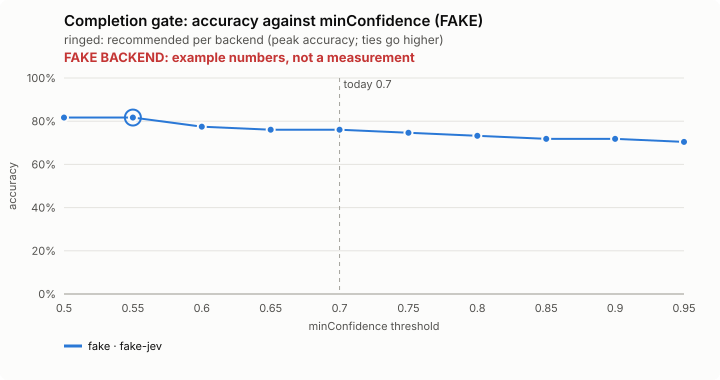
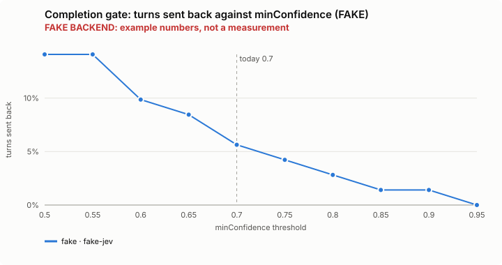
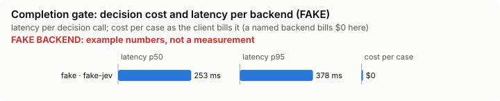

# Completion gate: bench summary (FAKE backend)

> **FAKE BACKEND.** These numbers come from the bench's fake decision model and show only that the pipeline works. They say nothing about any model.

**Bench** (`bun src/bench/report.ts stop-gate`; 0.11.0@c226712). Threshold swept: `minConfidence` (today 0.7). Recommended = where accuracy peaks; a tie goes to the higher value: a higher bar sends the agent back less often; a claim it leans against but is less sure of is only noted as unverified, and a turn stops rather than being pushed.

| backend · model | cases | recommended | accuracy | precision | recall | F1 | turns sent back | accused shown | could-not-tell found | verdicts right | claim items | p50 | p95 | cost/case |
|---|---|---|---|---|---|---|---|---|---|---|---|---|---|---|
| fake · fake-jev | 62 | 0.55 | 81.7% | 90.0% | 42.9% | 58.1% | 14.1% | 0 | 2 | 47 | 62 | 253 ms | 378 ms | $0 |

Recommended per backend:

- fake · fake-jev: minConfidence 0.55 (accuracy 81.7%; today's 0.7: 76.1%)

