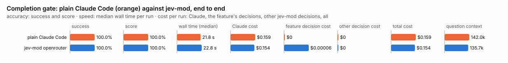

# Completion gate: bench summary

**Bench** (`bun src/bench/report.ts stop-gate`; 0.11.0@14f7f68, 0.12.0@55065cf).

- **One case:** what a Claude turn did (edits, commands and their output) and its final message, for example "all tests pass", with whether the evidence backs that claim and whether it stopped on an unfinished step.
- **Measured:** whether Jev sends the agent back when the claim is not shown or a step was left, and not when it is. Letting a false "done" stop the turn is the costly miss.
- **The setting:** how sure Jev must be that a claim is not backed before the agent is sent back. Higher sends it back less often, and a doubtful claim is only noted. (`minConfidence`, default 0.9)

**Compared with plain Claude Code:**

| arm | runs | success | mean score | median time | total time | Claude cost | feature decision cost | other jev-mod decision cost | total cost |
|---|---|---|---|---|---|---|---|---|---|
| plain Claude Code | 8 | 100.0% | 100.0% | 21.8 s | 196.6 s | $0.159 | $0 | $0 | $0.159 |
| jev-mod openrouter | 8 | 100.0% | 100.0% | 22.8 s | 195.2 s | $0.154 | $0.00006 | $0 | $0.154 |

- success: the share of scored runs the checker marked right; mean score: its partial credit (the share of questions answered right, say).
- median time: over scored runs; total time: every run of the arm, failed ones too.
- costs are per scored run. Feature decision cost: what stop-gate's own decisions cost; other jev-mod decision cost: what other jev-mod features still asked in the arm (a protective feature the bench may not switch off, as the person has it). Total cost is Claude plus both. A failed run is never scored.
- plain Claude Code runs with jev-mod switched off whole, so it makes no decisions; a plain run that shows any is an error (`decisions_in_plain_arm`). Runs from jev-mod 0.12.0 and before switched off only the features that change what the model sees.

- jev-mod openrouter: right on 100.0% (plain Claude Code 100.0%) of runs, median 22.8 s (plain Claude Code 21.8 s), $0.154 (plain Claude Code $0.159) per run (Claude $0.154, stop-gate's decisions $0.00006, other jev-mod decisions $0).

| arm | question context | kept / dropped | Claude tokens |
|---|---|---|---|
| plain Claude Code | 142.0k | – | 144272 |
| jev-mod openrouter | 135.7k | – | 137901 |

- question context: what the last step read, in tokens (a smaller one is a compaction that worked); kept / dropped: messages the compaction kept and dropped, of those before it.

Spend in all: $2.501 Claude; $0.00048 decisions. A failed run is never scored, but its spend counts here.

**Decision level.** Jev answers each case by itself, and the bench replays its answers at every value of `minConfidence`. Best = where accuracy peaks; a tie goes to the higher value: a higher bar sends the agent back less often; a claim it leans against but is less sure of is only noted as unverified, and a turn stops rather than being pushed.

**What this means.** At the default 0.9, Jev makes the right send-back call on 87.3% of the questions over 62 turns. No value in the sweep does better, so the default stays.

| backend · model | cases | best | accuracy | precision | recall | F1 | turns sent back | accused shown | could-not-tell found | verdicts right | claim items | p50 | p95 | cost/case |
|---|---|---|---|---|---|---|---|---|---|---|---|---|---|---|
| openrouter · typesafe/jev-1.13-20260917 | 62 | 0.9 | 87.3% | 100.0% | 57.1% | 72.7% | 16.9% | 0 | 6 | 48 | 62 | 482 ms | 553 ms | $0.00003 |

- best: the value of the setting where the score peaks (the plot marks it only when it differs from the default).
- accuracy: the share of items where acting or not acting matched the label.
- precision: when the feature acts, how often acting was right.
- recall: of what it should have acted on, how much it did.
- F1: precision and recall in one number.
- turns sent back: the share of items the feature acts on, at the best value.
- accused shown: claims the evidence did back that were called not shown.
- could-not-tell found: claims the evidence could not settle that Jev said it could not tell.
- verdicts right: claim verdicts that match the label.
- claim items: claim verdicts judged.
- p50, p95: how long a decision call took (the middle one, and the slow end); cost/case: what the decision calls cost per case.

Best per backend:

- openrouter · typesafe/jev-1.13-20260917: minConfidence 0.9 (accuracy 87.3%; default 0.9: 87.3%)

