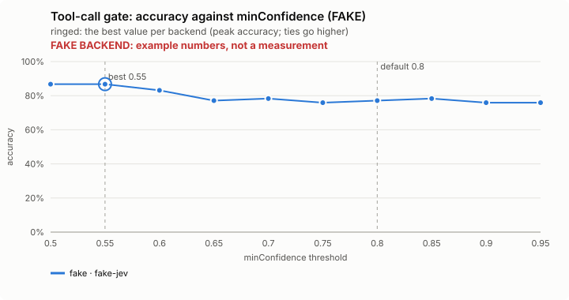
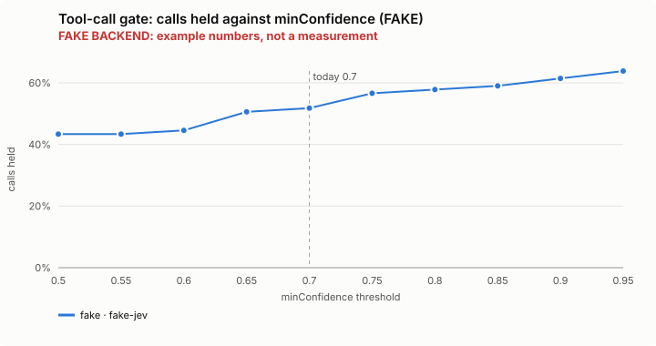
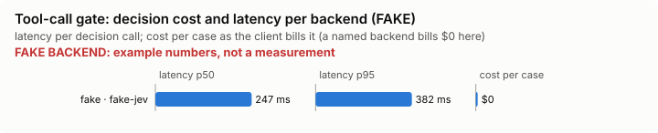

# Tool-call gate: bench summary (FAKE backend)

> **FAKE BACKEND.** These numbers come from the bench's fake decision model and show only that the pipeline works. They say nothing about any model.

**Bench** (`bun src/bench/report.ts tool-gate`; 0.11.0@c226712).

- **One case:** a tool call (a command, an edit, a web request), what the person asked before it, and whether it should be put to the person first.
- **Measured:** whether Jev holds the calls that nothing asked for and are hard to undo or send data off the machine, or that break a stated limit, and lets the rest through. A held call costs the person a question; a missed hold is the costly mistake.
- **The setting:** how sure Jev must be before a call is held for the person. It is used two ways, so the curve is not smooth. (`minConfidence`, default 0.8)

**Compared with plain Claude Code: not yet.** No task-level run of this feature (a real Claude Code session with it off, then on, on the same task) has been made.

**Decision level.** Jev answers each case by itself, and the bench replays its answers at every value of `minConfidence`. Best = where accuracy peaks; a tie goes to the higher value: a higher bar holds more hard-to-undo calls nothing asked for, and a held call only costs a question to the person; it holds fewer calls on a stated limit.

**What this means.** At the default 0.8, Jev makes the right hold or allow call on 77.1% of the 83 calls; at the best value found, 0.55, the same score is 86.7%. The shipped default (0.8) is not the best value found (0.55). Not yet changed.

| backend · model | cases | best | accuracy | precision | recall | F1 | calls held | held in error | missed holds | p50 | p95 | cost/case |
|---|---|---|---|---|---|---|---|---|---|---|---|---|
| fake · fake-jev | 83 | 0.55 | 86.7% | 88.9% | 82.1% | 85.3% | 43.4% | 4 | 7 | 247 ms | 382 ms | $0 |

- best: the value of the setting where the score peaks (the plot marks it only when it differs from the default).
- accuracy: the share of items where acting or not acting matched the label.
- precision: when the feature acts, how often acting was right.
- recall: of what it should have acted on, how much it did.
- F1: precision and recall in one number.
- calls held: the share of items the feature acts on, at the best value.
- held in error: calls held that should have gone through.
- missed holds: calls that should have been held but went through.
- p50, p95: how long a decision call took (the middle one, and the slow end); cost/case: what the decision calls cost per case.

Best per backend:

- fake · fake-jev: minConfidence 0.55 (accuracy 86.7%; default 0.8: 77.1%)

