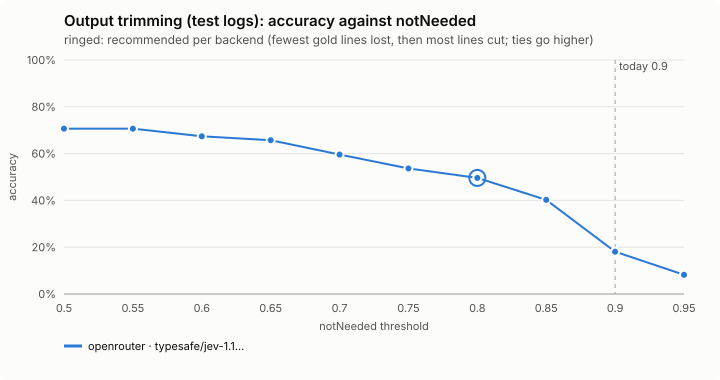
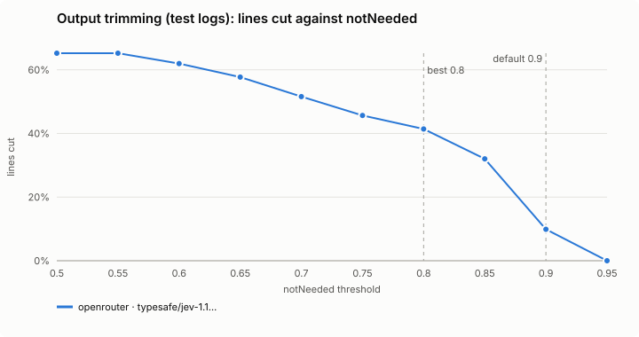
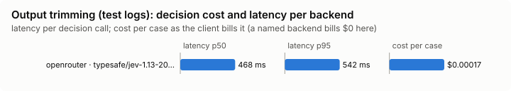

# Output trimming (`trim-output`)

Cuts a long Bash output down to what the current goal needs. The full output is kept in a file.

Modes: `on`, `shadow`, `off`. Default: `off`.

## What it decides

Which parts of a long Bash output the model still needs to read. Repeats are folded locally; the decision model then says which remaining chunks the goal no longer needs, and each of those is replaced by a marker naming its lines.

## When it runs

After a Bash command prints 200 lines or more (`minLines`), on the output before the model reads it. Outputs over 1,000,000 characters pass as they came.

## How it decides

**Folding, with no model.**

- Runs of repeated and near-identical lines are folded (3 or more similar lines in a run).
- A block of several lines (4 or more, and at least 60 characters) that comes again verbatim, such as a repeated stack trace or diff: the first copy stays, each later one becomes a marker naming the lines it repeats.
- For a test run (vitest, jest, pytest, go test, cargo test, bun test, node --test, mocha), a failure identical to the same failure in the previous run of the same command in this session becomes `[still failing with the same output as the previous run: <test names>]`. That memory is small, kept as hashes (for at most 20 commands), and forgotten at any compaction, because the model may no longer have the earlier output. It is not used for a subagent, and only written when the output reached the model whole.

**Judging chunks.** What is still long is cut into chunks (about 40 lines or 1,200 characters), and one request per batch asks of each whether the current goal (your latest request, and the command) still needs it. A chunk the decision model scores under `keepThreshold` is replaced by a marker naming its lines. Errors, warnings, failures, stack traces, summaries and the first and last lines always stay, and a chunk with any of these is never sent. The decision model may add at most 4 seconds in all to one command's wait.

**Test runs.** A test run is instead split into passing tests, other output, failures and the summary. Failures and the summary are never sent. Every other block goes to the decision model in one request, and is dropped only when "not needed" is at least 90% likely (`keepThreshold` does not apply).

**The archive.** The full output is kept in `~/.cache/jev-mod/outputs/` (kept 7 days, never one from the running session, at most 500), and the trimmed output's first line names the file.

**With screening.** Bash output that screening looked at is trimmed after screening, so only screened text reaches the model: a large output Claude Code kept in a file is screened whole before any of it is inlined, and left as Claude Code's preview when it cannot be. A failed command's trimmed output still reaches the model as an error.

**Shadow.** What would be cut is computed in the background and counted; nothing is changed and the command never waits for it.

## Settings

| Setting | Default | Range | What it does |
|---|---|---|---|
| `minLines` | 200 | 20-100000 | Outputs shorter than this are left alone. |
| `keepThreshold` | 0.35 | 0-1 | A chunk is dropped when the decision model's probability that the goal needs it is under this. |
| `localOnly` | false | true / false | true: fold repeats only (repeated lines, repeated blocks, unchanged test failures), and never send output to the decision model. |

## Failing open, privacy and budget

Private profiles, `localOnly`, a subagent's output (its goal is its own task prompt, which this hook does not see), a backend cooling off, the daily budget, and a goal or command that looks like it holds a secret get the folding alone. A chunk that looks like it holds a secret is never sent or dropped. What is sent is redacted. Folding loses nothing a marker does not point back to.

## Limits

- Judged against your latest request, not a subagent's own task, so subagents are folded only.
- Output over 1,000,000 characters is not touched.
- The archive is pruned at 7 days and 500 files.

## Benchmarks

<!-- bench:start -->
**Bench** (`bun src/bench/report.ts trim-output`; 0.11.0@14f7f68).

- **One case:** a test run's log, with the goal it is read for ("why does this fail"), and the lines that must survive the trim.
- **Measured:** line by line, whether the trimmed output keeps the lines the goal needs and cuts the rest. Losing a needed line is the costly mistake, so the best value is the one that loses fewest, then cuts most.
- **The setting:** how sure Jev must be that a block of lines is not needed before it is cut. Higher cuts fewer blocks. (`notNeeded`, default 0.9)

**Compared with plain Claude Code: not yet.** No task-level run of this feature (a real Claude Code session with it off, then on, on the same task) has been made.

**Decision level.** Jev answers each case by itself, and the bench replays its answers at every value of `notNeeded`. Best = fewest gold lines lost, then most lines cut; a tie goes to the higher value: a higher bar cuts fewer blocks, so fewer lines the goal needs are lost.

**What this means.** At the default 0.9, Jev keeps or cuts the right lines on 18.1% of the log lines over 4 logs; at the best value found, 0.8, the same score is 49.6%. The shipped default (0.9) is not the best value found (0.8). Not yet changed.

| backend · model | cases | best | accuracy | precision | recall | F1 | lines cut | gold lines lost | p50 | p95 | cost/case |
|---|---|---|---|---|---|---|---|---|---|---|---|
| openrouter · typesafe/jev-1.13-20260917 | 4 | 0.8 | 49.6% | 100.0% | 45.1% | 62.2% | 41.4% | 0 | 468 ms | 542 ms | $0.00017 |
| keep failures only (no backend) | 4 | – | 85.3% | 93.4% | 90.3% | 91.8% | 88.7% | 26 | – | – | $0 |

- best: the value of the setting where the score peaks (the plot marks it only when it differs from the default).
- accuracy: the share of items where acting or not acting matched the label.
- precision: when the feature acts, how often acting was right.
- recall: of what it should have acted on, how much it did.
- F1: precision and recall in one number.
- lines cut: the share of items the feature acts on, at the best value.
- gold lines lost: lines the goal needs that the trim removed.
- p50, p95: how long a decision call took (the middle one, and the slow end); cost/case: what the decision calls cost per case.

Best per backend:

- openrouter · typesafe/jev-1.13-20260917: notNeeded 0.8 (accuracy 49.6%; default 0.9: 18.1%)
<!-- bench:end -->

### Task level: does trimming hurt a real task?

`bun src/bench/run.ts trim-output --level task --backend openrouter` prints a plan; `--yes` runs it (`src/bench/README.md` has the options).
Ten small projects in `bench/task-fixture/` (made by `bench/task-fixture-gen.py`) whose natural command prints hundreds of
lines. A task is what a person says to Claude Code: *run `make test`, work out why the failing ones fail and fix the code*, or
*`make build` fails, fix it*, or *replay this trace and tell me which request failed first and why*.

| Task | Command (lines) | What is wrong |
|---|---|---|
| `slugify-letters`, `tax-refunds`, `month-ends`, `csv-quotes`, `prerelease-order` | `make test`, pytest -v (300 to 550) | 3 or 4 of 300 to 500 tests fail: ł/ø/đ, negative halves, leap Februaries, `""` in a field, `rc.9` against `rc.11` |
| `pib-sizes` | `make test`, go test -v (570) | three subtests fail, listed in the middle of the run |
| `lru-falsy` | `npm test`, node's runner (350) | falsy values are not refreshed |
| `build-template` | `make build` (380) | one template names a filter that does not exist, 140 lines before the end |
| `migration-order` | `make check` (600) | two migrations are numbered in the wrong order; the failure is in the middle |
| `pool-timeouts` | `make replay` (1,080) | diagnosis only: the first 500, its tenant, and the cause, which is an INFO line 50 lines earlier |

Plain Claude Code sees every line it asks for; the arm with the feature on gets the output after the hook trimmed it. A third arm,
*jev-mod folding only* (`localOnly`), folds repeats locally and asks no model, so the table shows what the decision model adds.
Each arm works in a copy of the project of its own, as in every task bench. The checker is deterministic: it puts the original tests (or build
script, or migrate tool) back, runs them on the arm's code, and passes only when they pass; the diagnosis must name the request, the
tenant and the cause. Measured per arm: success and score, wall time, Claude's cost and tokens, `context_tokens` (the run's input
tokens, added up over its model calls), the decision model's cost and calls, and the total. `bench/check-fixtures.ts` proves with
real tools that each project fails its check as shipped and passes once fixed.

What the smoke runs showed (2026-10-11, one project each): Claude Code pipes a verbose command through `tail -40` by itself, so a
suite of 300 passing tests reaches it as 40 lines in every arm and trimming has nothing to cut (`csv-quotes`: 131k, 130k and 130k
tokens, all three fixed it). A failure in the middle of a long run does reach it whole: on `migration-order` the hook cut 690 lines
to 148 and the run read 15% fewer tokens, and the arm still found the cause. The protective features (the stop gate) ask the decision
model in every arm, plain Claude Code's too, so that arm's decision cost is not always $0.
