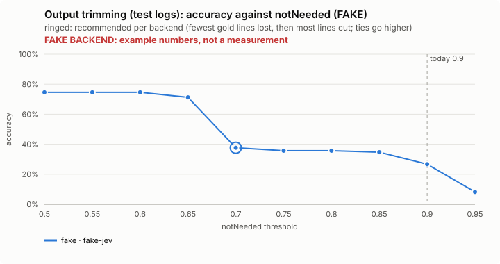
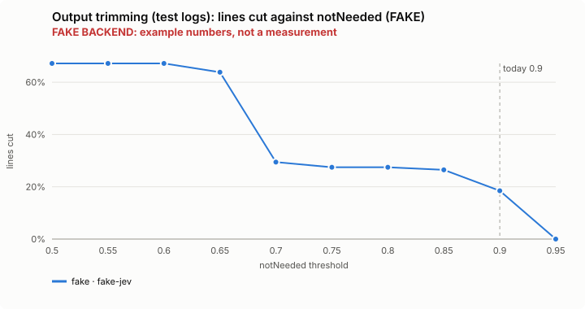
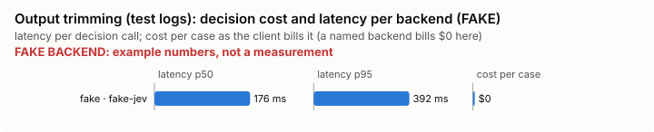

# Output trimming (test logs): bench summary (FAKE backend)

> **FAKE BACKEND.** These numbers come from the bench's fake decision model and show only that the pipeline works. They say nothing about any model.

**Bench** (`bun src/bench/report.ts trim-output`; 0.10.0@f040686).

- **One case:** a test run's log, with the goal it is read for ("why does this fail"), and the lines that must survive the trim.
- **Measured:** line by line, whether the trimmed output keeps the lines the goal needs and cuts the rest. Losing a needed line is the costly mistake, so the best value is the one that loses fewest, then cuts most.
- **The setting:** how sure Jev must be that a block of lines is not needed before it is cut. Higher cuts fewer blocks. (`notNeeded`, default 0.9)

**Compared with plain Claude Code: not yet.** No task-level run of this feature (a real Claude Code session with it off, then on, on the same task) has been made.

**Decision level.** Jev answers each case by itself, and the bench replays its answers at every value of `notNeeded`. Best = fewest gold lines lost, then most lines cut; a tie goes to the higher value: a higher bar cuts fewer blocks, so fewer lines the goal needs are lost.

**What this means.** At the default 0.9, Jev keeps or cuts the right lines on 26.7% of the log lines over 4 logs; at the best value found, 0.7, the same score is 37.6%. The shipped default (0.9) is not the best value found (0.7). Not yet changed.

| backend · model | cases | best | accuracy | precision | recall | F1 | lines cut | gold lines lost | p50 | p95 | cost/case |
|---|---|---|---|---|---|---|---|---|---|---|---|
| fake · fake-jev | 4 | 0.7 | 37.6% | 100.0% | 32.1% | 48.6% | 29.4% | 0 | 176 ms | 392 ms | $0 |
| keep failures only (no backend) | 4 | – | 85.3% | 93.4% | 90.3% | 91.8% | 88.7% | 26 | – | – | $0 |

- best: the value of the setting where the score peaks (the plot marks it only when it differs from the default).
- accuracy: the share of items where acting or not acting matched the label.
- precision: when the feature acts, how often acting was right.
- recall: of what it should have acted on, how much it did.
- F1: precision and recall in one number.
- lines cut: the share of items the feature acts on, at the best value.
- gold lines lost: lines the goal needs that the trim removed.
- p50, p95: how long a decision call took (the middle one, and the slow end); cost/case: what the decision calls cost per case.

Best per backend:

- fake · fake-jev: notNeeded 0.7 (accuracy 37.6%; default 0.9: 26.7%)

