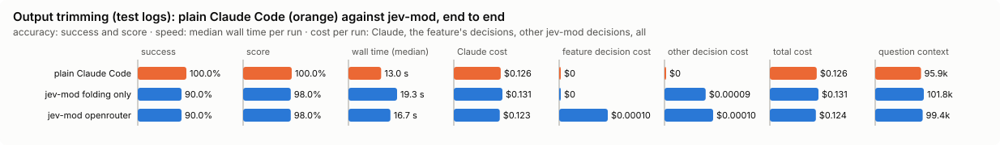

# Output trimming (test logs): bench summary

**Bench** (`bun src/bench/report.ts trim-output`; 0.11.0@14f7f68, 0.12.0@55065cf).

- **One case:** a test run's log, with the goal it is read for ("why does this fail"), and the lines that must survive the trim.
- **Measured:** line by line, whether the trimmed output keeps the lines the goal needs and cuts the rest. Losing a needed line is the costly mistake, so the best value is the one that loses fewest, then cuts most.
- **The setting:** how sure Jev must be that a block of lines is not needed before it is cut. Higher cuts fewer blocks. (`notNeeded`, default 0.9)

**Compared with plain Claude Code:**

| arm | runs | success | mean score | median time | total time | Claude cost | feature decision cost | other jev-mod decision cost | total cost |
|---|---|---|---|---|---|---|---|---|---|
| plain Claude Code | 10 | 100.0% | 100.0% | 13.0 s | 154.6 s | $0.126 | $0 | $0 | $0.126 |
| jev-mod folding only | 10 | 90.0% | 98.0% | 19.3 s | 189.1 s | $0.131 | $0 | $0.00009 | $0.131 |
| jev-mod openrouter | 10 | 90.0% | 98.0% | 16.7 s | 204.9 s | $0.123 | $0.00010 | $0.00010 | $0.124 |

- success: the share of scored runs the checker marked right; mean score: its partial credit (the share of questions answered right, say).
- median time: over scored runs; total time: every run of the arm, failed ones too.
- costs are per scored run. Feature decision cost: what trim-output's own decisions cost; other jev-mod decision cost: what other jev-mod features still asked in the arm (a protective feature the bench may not switch off, as the person has it). Total cost is Claude plus both. A failed run is never scored.
- plain Claude Code runs with jev-mod switched off whole, so it makes no decisions; a plain run that shows any is an error (`decisions_in_plain_arm`). Runs from jev-mod 0.12.0 and before switched off only the features that change what the model sees.

- jev-mod folding only: right on 90.0% (plain Claude Code 100.0%) of runs, median 19.3 s (plain Claude Code 13.0 s), $0.131 (plain Claude Code $0.126) per run (Claude $0.131, trim-output's decisions $0, other jev-mod decisions $0.00009).
- jev-mod openrouter: right on 90.0% (plain Claude Code 100.0%) of runs, median 16.7 s (plain Claude Code 13.0 s), $0.124 (plain Claude Code $0.126) per run (Claude $0.123, trim-output's decisions $0.00010, other jev-mod decisions $0.00010).

| arm | question context | kept / dropped | Claude tokens |
|---|---|---|---|
| plain Claude Code | 95.9k | – | 97122 |
| jev-mod folding only | 101.8k | – | 103182 |
| jev-mod openrouter | 99.4k | – | 100728 |

- question context: what the last step read, in tokens (a smaller one is a compaction that worked); kept / dropped: messages the compaction kept and dropped, of those before it.

Spend in all: $3.799 Claude; $0.00296 decisions. A failed run is never scored, but its spend counts here.

**Decision level.** Jev answers each case by itself, and the bench replays its answers at every value of `notNeeded`. Best = fewest gold lines lost, then most lines cut; a tie goes to the higher value: a higher bar cuts fewer blocks, so fewer lines the goal needs are lost.

**What this means.** At the default 0.9, Jev keeps or cuts the right lines on 18.1% of the log lines over 4 logs; at the best value found, 0.8, the same score is 49.6%. The shipped default (0.9) is not the best value found (0.8). Not yet changed.

| backend · model | cases | best | accuracy | precision | recall | F1 | lines cut | gold lines lost | p50 | p95 | cost/case |
|---|---|---|---|---|---|---|---|---|---|---|---|
| openrouter · typesafe/jev-1.13-20260917 | 4 | 0.8 | 49.6% | 100.0% | 45.1% | 62.2% | 41.4% | 0 | 468 ms | 542 ms | $0.00017 |
| keep failures only (no backend) | 4 | – | 85.3% | 93.4% | 90.3% | 91.8% | 88.7% | 26 | – | – | $0 |

- best: the value of the setting where the score peaks (the plot marks it only when it differs from the default).
- accuracy: the share of items where acting or not acting matched the label.
- precision: when the feature acts, how often acting was right.
- recall: of what it should have acted on, how much it did.
- F1: precision and recall in one number.
- lines cut: the share of items the feature acts on, at the best value.
- gold lines lost: lines the goal needs that the trim removed.
- p50, p95: how long a decision call took (the middle one, and the slow end); cost/case: what the decision calls cost per case.

Best per backend:

- openrouter · typesafe/jev-1.13-20260917: notNeeded 0.8 (accuracy 49.6%; default 0.9: 18.1%)

