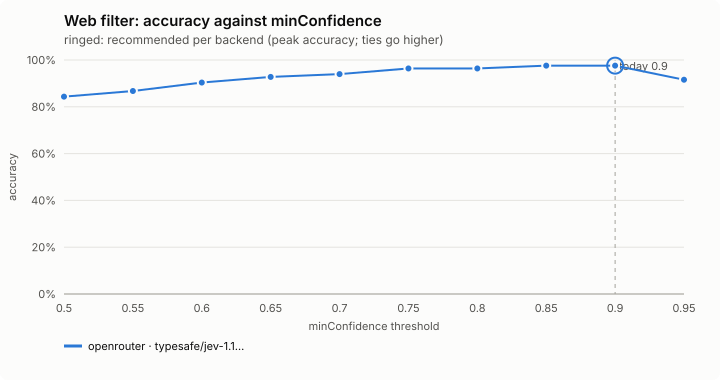
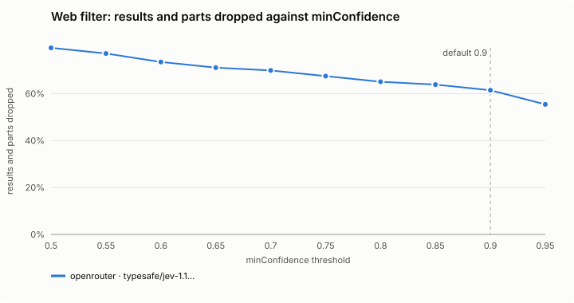
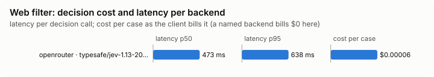

# Web filter (`web-filter`)

Drops search results and parts of long fetched pages the question does not need.

Modes: `on`, `shadow`, `off`. Default: `off`.

## What it decides

Which search results, and which parts of a long fetched page, your question needs. The rest is cut, with a marker saying what.

## When it runs

After WebSearch, and after a WebFetch of 4,000 characters or more (`fetchMinChars`). It runs after screening, on the screened text, so it never puts unscreened text in front of the model.

## How it decides

**Search.** One request asks of each result (title, URL, snippet; up to 30 results) whether it helps the search query and your latest request. A result the decision model is at least `minConfidence` (0.8) sure does not help goes, and so does a later copy of the same URL. The first `keepTop` (3) results always stay, in their order, and the list ends with a line saying how many went.

**Fetch.** The text is cut into parts of about 2,000 characters (20% overlap, at paragraphs) and one request asks which parts the fetch's prompt and your request need. Each run of dropped parts becomes a marker naming what was cut. Kept without asking: the first part, and any part with code, a date, a figure (money, a percentage, a version, a measurement) or a heading or number the question names.

**Hosts you name.** Nothing is cut from a page whose host your request names.

**Subagents.** A subagent's call is judged by its query or fetch prompt alone.

**Shadow.** What would be dropped is judged in the background and counted; nothing changes and nothing waits for it. The band shows what the filter cut (`🔎 cut 7 · 12.3k chars`), or `would cut` in shadow.

## Settings

| Setting | Default | Range | What it does |
|---|---|---|---|
| `minConfidence` | 0.9 | 0.5-1 | How sure the decision model must be that a result does not help, or a part is not needed, for it to be dropped. |
| `keepTop` | 3 | 1-10 | The first this many distinct search results always stay, in their order. |
| `fetchMinChars` | 4000 | 2000-100000 | A WebFetch result shorter than this is left alone. |
| `timeoutMs` | 3000 | 1000-10000 | How long the result waits for the decision model before it passes unchanged. |

## Failing open, privacy and budget

No key, private mode, the daily budget, a backend cool-off, no answer within `timeoutMs`, or a query or request that looks like it holds a secret: the result passes unchanged. What is sent is redacted.

## Limits

- Results and parts are judged from a snippet or a clip of at most 2,400 characters, not the whole page behind them.
- A page on a host your request names is never cut.

## Benchmarks

<!-- bench:start -->
**Bench** (`bun src/bench/report.ts web-filter`; 0.11.0@14f7f68). Threshold swept: `minConfidence` (today 0.9). Recommended = where accuracy peaks; a tie goes to the higher value: a higher bar drops fewer results and parts, and a dropped one is gone from what the model reads.

| backend · model | cases | recommended | accuracy | precision | recall | F1 | results and parts dropped | p50 | p95 | cost/case |
|---|---|---|---|---|---|---|---|---|---|---|
| openrouter · typesafe/jev-1.13-20260917 | 19 | 0.9 | 97.6% | 100.0% | 96.2% | 98.1% | 61.4% | 473 ms | 638 ms | $0.00006 |

Recommended per backend:

- openrouter · typesafe/jev-1.13-20260917: minConfidence 0.9 (accuracy 97.6%; today's 0.9: 97.6%)
<!-- bench:end -->
