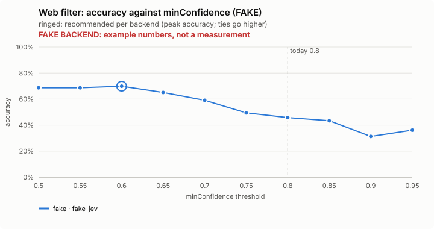
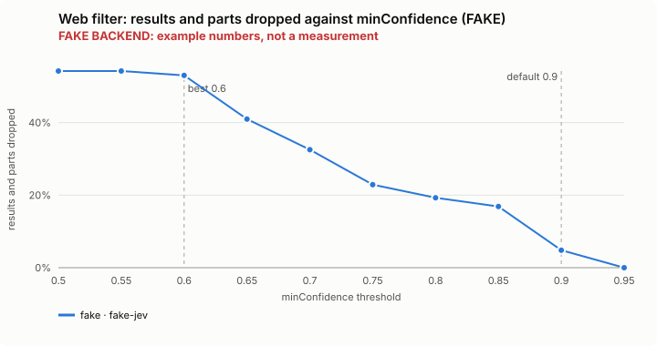
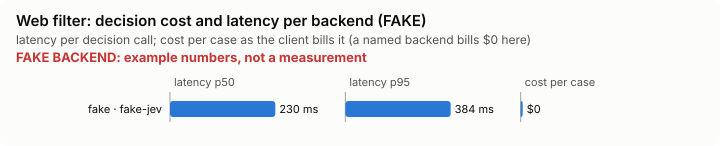

# Web filter: bench summary (FAKE backend)

> **FAKE BACKEND.** These numbers come from the bench's fake decision model and show only that the pipeline works. They say nothing about any model.

**Bench** (`bun src/bench/report.ts web-filter`; 0.11.0@c226712). Threshold swept: `minConfidence` (today 0.8). Recommended = where accuracy peaks; a tie goes to the higher value: a higher bar drops fewer results and parts, and a dropped one is gone from what the model reads.

| backend · model | cases | recommended | accuracy | precision | recall | F1 | results and parts dropped | p50 | p95 | cost/case |
|---|---|---|---|---|---|---|---|---|---|---|
| fake · fake-jev | 19 | 0.6 | 69.9% | 81.8% | 67.9% | 74.2% | 53.0% | 230 ms | 384 ms | $0 |

Recommended per backend:

- fake · fake-jev: minConfidence 0.6 (accuracy 69.9%; today's 0.8: 45.8%)

