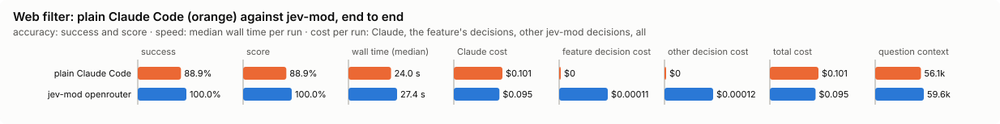

# Web filter: bench summary

**Bench** (`bun src/bench/report.ts web-filter`; 0.11.0@14f7f68, 0.12.0@55065cf).

- **One case:** a web search (its results) or a long fetched page (cut into parts), with what the person asked, and for each result or part whether it helps.
- **Measured:** whether Jev drops what does not help and keeps what does. A dropped result is gone from what Claude reads, so dropping a useful one is the costly mistake.
- **The setting:** how sure Jev must be that a result or part is not needed before it is dropped. Higher drops fewer. (`minConfidence`, default 0.9)

**Compared with plain Claude Code:**

| arm | runs | success | mean score | median time | total time | Claude cost | feature decision cost | other jev-mod decision cost | total cost |
|---|---|---|---|---|---|---|---|---|---|
| plain Claude Code | 9 | 88.9% | 88.9% | 24.0 s | 215.5 s | $0.101 | $0 | $0 | $0.101 |
| jev-mod openrouter | 9 | 100.0% | 100.0% | 27.4 s | 251.3 s | $0.095 | $0.00011 | $0.00012 | $0.095 |

- success: the share of scored runs the checker marked right; mean score: its partial credit (the share of questions answered right, say).
- median time: over scored runs; total time: every run of the arm, failed ones too.
- costs are per scored run. Feature decision cost: what web-filter's own decisions cost; other jev-mod decision cost: what other jev-mod features still asked in the arm (a protective feature the bench may not switch off, as the person has it). Total cost is Claude plus both. A failed run is never scored.
- plain Claude Code runs with jev-mod switched off whole, so it makes no decisions; a plain run that shows any is an error (`decisions_in_plain_arm`). Runs from jev-mod 0.12.0 and before switched off only the features that change what the model sees.

- jev-mod openrouter: right on 100.0% (plain Claude Code 88.9%) of runs, median 27.4 s (plain Claude Code 24.0 s), $0.095 (plain Claude Code $0.101) per run (Claude $0.095, web-filter's decisions $0.00011, other jev-mod decisions $0.00012).

| arm | question context | kept / dropped | Claude tokens |
|---|---|---|---|
| plain Claude Code | 56.1k | – | 56439 |
| jev-mod openrouter | 59.6k | – | 60017 |

- question context: what the last step read, in tokens (a smaller one is a compaction that worked); kept / dropped: messages the compaction kept and dropped, of those before it.

Spend in all: $1.760 Claude; $0.00209 decisions. A failed run is never scored, but its spend counts here.

**Decision level.** Jev answers each case by itself, and the bench replays its answers at every value of `minConfidence`. Best = where accuracy peaks; a tie goes to the higher value: a higher bar drops fewer results and parts, and a dropped one is gone from what the model reads.

**What this means.** At the default 0.9, Jev keeps or drops the right results and parts on 97.6% of the questions over 19 cases. No value in the sweep does better, so the default stays.

| backend · model | cases | best | accuracy | precision | recall | F1 | results and parts dropped | p50 | p95 | cost/case |
|---|---|---|---|---|---|---|---|---|---|---|
| openrouter · typesafe/jev-1.13-20260917 | 19 | 0.9 | 97.6% | 100.0% | 96.2% | 98.1% | 61.4% | 473 ms | 638 ms | $0.00006 |

- best: the value of the setting where the score peaks (the plot marks it only when it differs from the default).
- accuracy: the share of items where acting or not acting matched the label.
- precision: when the feature acts, how often acting was right.
- recall: of what it should have acted on, how much it did.
- F1: precision and recall in one number.
- results and parts dropped: the share of items the feature acts on, at the best value.
- p50, p95: how long a decision call took (the middle one, and the slow end); cost/case: what the decision calls cost per case.

Best per backend:

- openrouter · typesafe/jev-1.13-20260917: minConfidence 0.9 (accuracy 97.6%; default 0.9: 97.6%)

